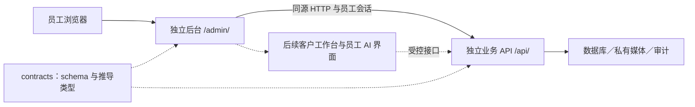

# 员工后台架构与演进

2026-11-08（Asia/Shanghai）｜维护：AD｜本轮 AD-DEL-01（回收站与外部来源录入）。

本文维护后台的技术边界与扩展方案；实际任务状态见[后台任务书](../协作/后台.md)，运行命令见[应用说明](../../apps/admin/README.md)，车辆协议以[车辆接口](车辆接口.md)及 `@hd/contracts` 为准。未来模块属于设计，只有代码、验证和角色日志对应的能力才算已实现。

## 1. 本次范围与方向

用户本次要求以 AD 角色规划并分步实施后台，后续将员工 AI 对话、客户资料与信息标注放在同一后台。这扩展了旧路线图中“不另建 CRM”的方向：规划自有客户资料与跟进工作台，既有 SaleSmartly 继续负责外部消息接待；是否同步会话与客户、谁是各字段的主记录，在 CRM 阶段与 BE／PM 明确。本轮不迁移 SaleSmartly 数据、不连接模型或建立消息发送能力。

当前代码基线中，API 与公共契约已有员工身份、车辆草稿、媒体、发布、库存、首页配置的本地实现，后台已完成独立工程、登录／草稿和本地单车发布闭环，首页配置和 Ant Design 工作台也已落地；官网由 FE 独立消费公开 API。当前 AD-DEL-01 在其上补可恢复删除和外部来源录入，实际验收按本轮日志核对；不以空菜单、模拟成功或预建空表代表未来能力。

## 2. 应用与模块边界

后台为 `apps/admin` 独立 React／Vite／TypeScript 应用，以 React Router 的 `createBrowserRouter`／`RouterProvider` 装配路由，`basename=/admin`，支持编辑离开拦截。后台默认中文，构建产物由 `/admin/` 提供；开发端口为 `127.0.0.1:3318`。浏览器请求相对路径 `/api`，开发代理转发本机 API 3320；生产同源代理由 OPS 配置并验证。直接打开或刷新 `/admin/vehicles/:id` 时，静态服务须回退到后台入口，不能落入官网或吞掉 `/api` 请求。

源码按实际功能建立，不为未来模块先创建空目录：

| 位置 | 职责 |
| --- | --- |
| `src/main.tsx` | 路由、权限入口与页面装配；应用壳当前位于 auth 模块 |
| `src/modules/auth/` | 员工登录、身份加载、退出与会话失效 |
| `src/modules/vehicles/` | 列表、草稿、媒体、发布、库存与回收站操作 |
| `src/modules/home/` | 两组首页车源的配置与顺序 |
| 后续 `src/modules/customers/` | 客户资料、标签、事实标注与跟进 |
| 后续 `src/modules/assistant/` | 员工 AI 会话、引用与工具执行状态 |
| `src/shared/` | HTTP、通用错误与真正跨模块的基础样式／交互 |

依赖方向为应用装配 → 模块公共入口 → 模块内部／shared；shared 不引用业务模块。后台不导入官网或 API 的内部源码，数据库模型与权限判断只在 API。公共 DTO 从 `@hd/contracts/admin` 等正式出口使用；未来客户与 AI 契约由 BE 增加可检查 schema，后台不在页面另造一套协议。每个应用声明自己的依赖，共用锁文件由当轮集成人串行维护。

员工工作台采用 Ant Design 6.7、图标6.3与统一ConfigProvider/App上下文，默认中文、深色导航和内容卡片；用Table/Form/Tabs/Upload/Modal组织车辆、首页和确认流程，不引入ProComponents。页面内状态和明确加载／保存状态继续承担业务编辑，不引入全局数据框架或插件系统。模块增多后再依据实际跨页数据需求选型。库存、客户权限与会话始终由服务端决定，前端缓存不能成为事实来源。

## 3. 会话、错误与编辑可靠性

- 登录／退出沿用 Better Auth 原生协议；身份和业务权限读取 `/api/v1/admin/me`。Cookie 由服务端管理，浏览器不保存自制 token、密码、数据库或模型密钥。界面隐藏无权限入口，API 仍须逐请求授权。
- HTTP 层携带同源会话，成功 JSON 按公共 schema 校验；鉴权原生响应与业务 envelope 分开处理。失败显示可理解的中文提示与 requestId，不原样展示堆栈。401 要求重新登录；403 不当成普通空列表；错误、真实空数据、加载中分别展示。
- 编辑态保存在内存，不把内部成本、客户资料或会话内容默认持久化到浏览器存储。未保存离开给予提示。会话过期以登录弹层阻止继续操作，同一员工重新登录后恢复编辑；换账号不得继承上一个员工的草稿。主动退出清除敏感页面状态。
- 保存草稿不发布。草稿版本、发布状态、库存状态分别展示；服务成功后才更新完成提示。金额保持十进制字符串和币种；缺失事实为 null，不填假日期、假里程或零报价。
- 更新携带服务端版本；409 保留本地输入并读取当前版本供比较。重新加载须让员工明确选择，不能静默覆盖本地修改，也不能自动用最新版本重发旧内容。
- 创建／发布使用幂等键。一次意图固定请求体与键；结果不明时重试原请求，不能一边改内容一边复用旧键，也不能换键盲目重复创建。无成功响应不能显示已保存。429／503 不无限自动重试，手动重试遵循服务端限制。
- 三语文本的原文版本、译文来源、审核状态相互独立；修改原文后由服务标记过期，保存价格不应改写文本版本。AI 或机器译文不能自动标成人工审核通过。
- 输入错误关联字段，关键动作有明确名称；键盘焦点、长中文／俄文、320px 及正常手机宽度均需验证。未实现操作不给可点击的假成功按钮。

## 4. 客户资料与标注工作台

以下为 AD-CRM-01 的设计边界，当前没有对应管理接口或数据库表。先把客户资料、跟进和关联车辆做成可操作的小闭环，再考虑会话同步、报价与批量导入。

| 概念 | 建议职责与关系 |
| --- | --- |
| 客户档案 | 自有稳定 ID、个人／企业类型、显示名、负责人、状态；国家、语言、币种分别保存 |
| 联系方式 | 与客户一对多；渠道、规范值、核实状态及来源；不从昵称推断身份，不因同电话自动合并 |
| 外部关联 | SaleSmartly 等系统 ID 与自有客户 ID 的映射；同步方向、更新时间、冲突处理有明确归属 |
| 需求与关联车辆 | 预算及币种、目的地、需求说明、稳定车辆 ID；需求不等于订单，关注不等于成交 |
| 标签与信息标注 | 标签有规范 ID；标注记录目标字段／记录、内容、来源、作者、时间及确认状态，事实与员工判断分开 |
| 跟进记录 | 时间、负责人、方式、摘要、下次动作；已发送消息须有真实发送证据，不把计划写成已发生 |
| 变更审计 | 谁在何时新增、修改、合并或删除；业务历史与安全日志分开，日志不复制完整敏感内容 |

先由 BE／PM 与 AD 对齐字段字典、列表筛选、去重候选、负责人分配、访问范围与保留规则，再形成 schema／迁移及 fixtures。岗位权限和“仅本人／团队／全部客户”的数据范围由 API 执行；仅隐藏列表无法保护详情接口。敏感联系方式按职责展示，批量导出、删除与合并另有权限和影响说明。

客户事实纠正、标签、跟进使用版本校验；关联车辆通过稳定 ID 读取公开或授权管理投影，不能复制车辆表成为第二套库存。外部会话在同步协议明确前保留为链接或外部 ID，不静默抓取。客户资料与会话不默认进入 AI 上下文，也不进入公开接口或浏览器日志。

## 5. 员工 AI 先在后台使用

AD-AI-01 与后端 BE-AI-01 配合，第一版是员工只读查车助手，可在车辆运营稳定后开展，不强依赖 CRM。独立路由和会话区承载提问、响应、引用与工具状态；模型供应商、密钥、调用预算和工具授权由 API 负责。

- 第一版只读已允许公开的车源工具，即使当前用户是管理员也不扩大为草稿、成本或供应商资料读取。回答展示引用车号／详情及数据时间，无法确认时标明缺项；结果使用前重新核对库存与发布状态。
- 员工会话至少关联操作者、会话 ID 和时间；持久化、团队共享、保留时长与删除行为须在 BE 契约中落定。界面区分生成中、完成、取消与失败，流式中断不伪装完整答案；重试避免重复执行有副作用的工具。
- 车辆描述、客户文本、供应商材料和工具返回均作为数据，不作为改变工具权限的指令。AI 输出不执行脚本或未经检查的 HTML；引用链接由受控路径产生。
- 不提供任意 SQL、发布、改库存、发送真实消息或自动承诺报价的工具。后续 AI 可生成拟写内容，但写回成为草稿并由员工检查；是否新增执行工具另按具体任务设计权限、确认和审计。
- 记录工具名、操作者、请求标识、耗时／用量及结果状态，避免把完整客户消息或密钥复制到诊断日志。后端设置超时、并发、单次及员工额度，耗尽或服务失败时给出可恢复状态。
- CRM 上线后如需客户辅助，应单独明确可读取字段、本人／团队范围、脱敏和会话保留；服务端按每次调用鉴权，不把“员工能登录”当成访问所有客户的许可。客户辅助不自动继承公开查车工具的授权。

AI 测算和正式报价需要有版本的规则及人工确认；当前不抽取空计算包、不让模型猜税率。实际第二消费者出现时，由对应角色单独安排共享计算能力及回归。

## 6. 分阶段实施与协作

| 阶段 | 本阶段结果 | 可验证的完成条件 | 依赖与协作 |
| --- | --- | --- | --- |
| AD-ARCH-01 | 本架构与后台专用规范 | 入口可发现、区分实现／规划、协作事项有归属 | PM 后续同步范围变化与总进度 |
| AD-00 | 独立工程、路由、布局、API 层 | 独立启动／构建／类型检查；直接打开与刷新路径；应用边界通过 | 集成人更新共享锁文件和验证入口；OPS 对齐 `/admin/`、`/api` |
| AD-01a | 员工登录、列表、新建与编辑草稿 | 真实 Cookie 登录／退出；刷新读取已保存草稿；创建重试、409、401、空数据与错误可辨别 | 消费现有 BE-01/02 与 contracts；QA 用隔离合成数据联调 |
| AD-01b | 图片、三语审核、库存、发布与首页配置 | 录入到发布／下架走通；未发布不公开、已售退出推荐、封面／三语缺项可定位 | BE 现有接口；FE-01 正式详情／首页；真实图片依据由用户确认 |
| AD-02 | 日常运营可靠性 | 已发布／未发布修改可比较、失败恢复与审计可解释；首批真实车辆验证 | BE 操作记录查询如未提供则补契约；OPS 恢复与发布；用户资料 |
| AD-CRM-01 | 客户、标签／标注、跟进与车辆关联 | 录入→筛选→跟进→纠错；重复候选、版本冲突、越权与敏感字段检查 | BE 新契约／权限／持久化；PM 定义 SaleSmartly 主记录和同步边界 |
| AD-AI-01 | 员工只读查车会话 | 引用与缺项可追溯、下架不被推荐、取消／失败／限额可用；无写权限 | BE-AI-01 与模型服务；供应商及费用配置不进浏览器 |
| AD-AI-02 | 可选客户辅助与内容草拟 | 字段／数据范围授权、会话保留、人工检查及写入审计通过 | CRM 权限成熟、BE 专门工具契约；按实际需求实施 |

当前 AD-00／AD-01a 与 AD-01b 单车闭环已完成本地实现及验证；AD-INT-01 提供3318后台与3320 API的可登录试用和关键词／分类搜索。AD-UX-01 已补齐首页配置和批量工作台，官网由 FE 独立联调。AD-DEL-01 补齐回收站和外部来源消费。当前状态和证据以角色摘要／本轮日志为准。AD-CRM-01 与 AD-AI-01 可在各自契约就绪后独立推进，AI 查车不必等待客户库完成。阶段编号用于拆解依赖与验收边界，不增加每次重复询问的门槛；沿用用户授权推进可完成工作，缺少其他端能力时明确交接并继续不依赖它的部分。外部采购、生产部署或真实消息发送不由本规划自动授权。

每次开工通过[后台专用规范](../../.agents/skills/hd-auto-admin/SKILL.md)定位任务；每次交付更新角色摘要和日志，记录实际自测、独立审查与联调对象。PM 核对版本和证据后汇总，用户验收实际业务与视觉；Git、部署分别记录。

AD-UX-01补充：资料类型在创建后不可切换。展示样例用source.kind=demo显著标记“展示样例，非实际库存”，保持库存未知／待询价／不填写物理库存事实；三语当前非空且非stale可发布，pending不伪称人工审核。管理字典覆盖全部草稿与发布车辆。批量只做库存与下架，固定幂等请求和选择时版本，逐项成功／失败，冲突需员工读取并确认当前版本后新请求重试；不静默升级已选版本。实际接口以车辆契约第9节为准。

AD-DEL-01补充：删除是可恢复逻辑操作，与下架分开。列表显式exclude、回收站only，详情includeDeleted只读且不挂载媒体或发布组件。删除／恢复固定版本和幂等键，确认／处理中／未知结果锁住其他写操作与离开；回执可能是历史状态，必须重新读取后采用。恢复由API回到draft／unknown，不自动公开或加回首页。列表统一负责单车和批量的导航保护，避免同时注册多个路由blocker。

external保留正式source元数据与观察事实，平台／挂牌身份不可变；未知不补值，参考价不等于自有报价，库存始终unknown，pending内容不标成人审。每个上传任务冻结独立rights.source，原图URL与文件顺序一一对应、挂牌URL来自已保存来源。来源链接变化需先保存再上传。首页可选择已发布的external并显著标明来源，已删除记录不可选。协议以车辆接口第10节和packages/contracts实际schema为准。
