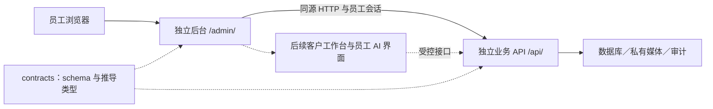

# 员工后台架构与演进

2026-11-12（Asia/Shanghai）｜维护：AD｜AD-UX-11 当前工作树流程；真实 API／FE 联调和 3363 切换尚未验收，阿里翻译尚未启用，本轮无付费翻译调用。

本文维护后台的技术边界与扩展方案；实际任务状态见[后台任务书](../协作/后台.md)，运行命令见[应用说明](../../apps/admin/README.md)，车辆协议以[车辆接口](车辆接口.md)及 `@hd/contracts` 为准。未来模块属于设计，只有代码、验证和角色日志对应的能力才算已实现。

## 1. 本次范围与方向

用户本次要求以 AD 角色规划并分步实施后台，后续将员工 AI 对话、客户资料与信息标注放在同一后台。这扩展了旧路线图中“不另建 CRM”的方向：规划自有客户资料与跟进工作台，既有 SaleSmartly 继续负责外部消息接待；是否同步会话与客户、谁是各字段的主记录，在 CRM 阶段与 BE／PM 明确。本轮不迁移 SaleSmartly 数据、不连接模型或建立消息发送能力。

API 与公共契约已有员工身份、车辆草稿、媒体、发布、库存、首页配置及外部目录能力，后台已有员工工作台、回收站和来源管理；官网由 FE 独立消费公开 API。AD-UX-11 在本轮工作树接入结构化详细配置、统一多语工作区、计划费用确认和来源报告入口。代码、契约模拟、真实三端联调、用户验收及运行切换分别记录；历史任务事实见第 6 节，不以旧验证证明本轮交付。

## 2. 应用与模块边界

后台为 `apps/admin` 独立 React／Vite／TypeScript 应用，以 React Router 的 `createBrowserRouter`／`RouterProvider` 装配路由，`basename=/admin`，支持编辑离开拦截。本机交付统一通过 `127.0.0.1:3363` 同源提供官网、`/admin/` 和 `/api`，内部依赖不作为用户入口。本轮 UX11 尚未完成该入口的联调验收与切换，当前运行组合由 OPS 记录。Vite 3318／API 3320 的旧试用组合属于历史；源码隔离开发可沿用内部端口和代理配置，不代表当前交付环境。直接打开或刷新 `/admin/vehicles/:id` 时，静态服务须回退到后台入口，不能落入官网或吞掉 `/api` 请求。Cookie、Origin 及同源代理由 API／OPS 按实际入口配置验证。

源码按实际功能建立，不为未来模块先创建空目录：

| 位置 | 职责 |
| --- | --- |
| `src/main.tsx` | 路由、权限入口与页面装配；应用壳当前位于 auth 模块 |
| `src/modules/auth/` | 员工登录、身份加载、退出与会话失效 |
| `src/modules/vehicles/` | 列表、草稿、详细配置、统一多语工作区、媒体、发布、库存与回收站操作 |
| `src/modules/external-sources/` | 三方 API 状态、挂牌、来源追溯及人工修订 |
| `src/modules/home/` | 两组首页车源的配置与顺序 |
| 后续 `src/modules/customers/` | 客户资料、标签、事实标注与跟进 |
| 后续 `src/modules/assistant/` | 员工 AI 会话、引用与工具执行状态 |
| `src/shared/` | HTTP、通用错误与真正跨模块的基础样式／交互 |

依赖方向为应用装配 → 模块公共入口 → 模块内部／shared；shared 不引用业务模块。后台不导入官网或 API 的内部源码，数据库模型与权限判断只在 API。公共 DTO 从 `@hd/contracts/admin` 等正式出口使用；未来客户与 AI 契约由 BE 增加可检查 schema，后台不在页面另造一套协议。每个应用声明自己的依赖，共用锁文件由当轮集成人串行维护。

员工工作台采用 Ant Design 6.7、图标6.3与统一ConfigProvider/App上下文，默认中文、黑金导航和暖白内容卡片；与官网同一Logo资源复制到后台public独立交付。用Table/Form/Tabs/Upload/Modal组织车辆、首页和确认流程，不引入ProComponents。页面内状态和明确加载／保存状态继续承担业务编辑，不引入全局数据框架或插件系统。模块增多后再依据实际跨页数据需求选型。库存、客户权限与会话始终由服务端决定，前端缓存不能成为事实来源。

## 3. 会话、错误与编辑可靠性

- 登录／退出沿用 Better Auth 原生协议；身份和业务权限读取 `/api/v1/admin/me`。Cookie 由服务端管理，浏览器不保存自制 token、密码、数据库或模型密钥。界面隐藏无权限入口，API 仍须逐请求授权。
- HTTP 层携带同源会话，成功 JSON 按公共 schema 校验；鉴权原生响应与业务 envelope 分开处理。失败显示可理解的中文提示与 requestId，不原样展示堆栈。401 要求重新登录；403 不当成普通空列表；错误、真实空数据、加载中分别展示。
- 编辑态保存在内存，不把内部成本、客户资料或会话内容默认持久化到浏览器存储。未保存离开给予提示。会话过期以登录弹层阻止继续操作，同一员工重新登录后恢复编辑；换账号不得继承上一个员工的草稿。主动退出清除敏感页面状态。
- 保存草稿不发布。草稿版本、发布状态、库存状态分别展示；服务成功后才更新完成提示。金额保持十进制字符串和币种；缺失事实为 null，不填假日期、假里程或零报价。
- 更新携带服务端版本；409 保留本地输入并读取当前版本供比较。重新加载须让员工明确选择，不能静默覆盖本地修改，也不能自动用最新版本重发旧内容。
- 创建／发布使用幂等键。一次意图固定请求体与键；结果不明时重试原请求，不能一边改内容一边复用旧键，也不能换键盲目重复创建。该恢复规则不适用于翻译 generate，其未知结果只 GET 状态。无成功响应不能显示已保存。429／503 不无限自动重试，手动重试遵循服务端限制。
- 三语文本的原文版本、译文来源、审核状态相互独立；修改原文后由服务标记过期，保存价格不应改写文本版本。AI 或机器译文不能自动标成人工审核通过。
- 输入错误关联字段，关键动作有明确名称；键盘焦点、长中文／俄文、320px 及正常手机宽度均需验证。未实现操作不给可点击的假成功按钮。

### AD-UX-11 车辆与详细配置

录入分为基础资料、车辆配置、价格与内部信息、图片管理、公开字段多语、发布预览六个分组。新增 manual／external 草稿默认 `registrationStatus=registered`，demo 保持 unknown；保留旧记录真实状态，不批量迁移。基础资料的 `trim` 配置名称继续保存，详细配置独立存于 `draft.configuration`，不能互相替代。

详细配置复用正式共享 schema 与解析器：`{version:1,items:[{name,value}]}`，name/value 均为非空字符串，最多 200 项；名称 100、值 500，合计 16000 个 UTF-16 单元，原始 JSON 最多 65536 UTF-8 字节。严格拒绝重复键、按 NFKC／trim／大小写比较重复的名称、未知属性、非法 Unicode 及格式错误，保留有效原始值、单位和顺序，不静默归一化或截断。空白可作为未完成草稿保存，非空非法内容阻止保存；manual／员工 external 副本发布必须有有效详细配置，demo 不受此必填门槛约束。复制 AI 提示词只复制文本，不产生外呼。

### AD-UX-11 统一多语与费用确认

`VehicleTranslationWorkspace` 以正式 `GET /vehicles/:id/translation-bundle` 获取同版本 vehicle 与 localization，正文、展示／配置译文经一个 bundle PUT 原子保存。车辆版本、localization revision、来源 hash 和人工版本共同保护数据；冲突保留输入供比较，不能通过分别保存两套表单造成部分写入。标题及车况描述引用已保存基础资料，中文来源和汇总只读；标题在基础资料编辑，描述在价格与内部信息编辑，详细配置在配置分组编辑。历史非 zh／und 保留真实元数据，先核对，再显式整页确认 `sourceLanguageConfirmations` 后保存，不能静默改成中文。

不再使用逐字段勾选、采用和审核按钮。新生成的中文结果保留 original/pending，英俄结果保留 machine/pending，不把机器结果改成 approved；既有 human／approved 内容受保护。用户编辑英俄后一次保存全部多语资料，源变更使旧译文失效。品牌词库保留现有 ID；展示字段 ref 由合同提供，图片绑定 mediaId，配置项绑定正式身份，不按位置复制译文，未知事实为 null，来源未知为 und。

生成只走正式 plan：保存中文和工作区 → 创建计划 → 显示固定字段范围、字符／请求上限及费用 → 明确确认同一不可变计划 → generate。计划绑定员工、车辆版本、多语修订、源指纹、供应商配置及 zh→en/ru，最多 472 个字段、有效 10 分钟；内部采购成本、备注和联系方式不进入翻译输入。unknown cost／免费额度未知必须如实展示，不能承诺免费，失败或中断可能已计费。客户端 generate 等待上限 150 秒，供应商密钥与预算只在 API；本轮阿里尚未启用，没有付费翻译调用。

generate 中断或结果未知时保留原意图，只 GET `/translation-plans/:planId` 查状态，绝不自动再次 POST。结果在核对最新 bundle 与计划身份后进入本地待保存值；完整及部分成功均不自动写入草稿或发布。结束计划不取消已开始的调用，再试必须创建新计划并重新确认范围／费用。保存结果未知与生成结果未知分开：bundle PUT 先 GET 比较，仅完整快照仍与提交前一致时才允许员工显式重试原保存正文；不能据此重发生成请求。dirty／busy／unknown 汇入父级写入与离开保护，不覆盖未保存输入。

### 当前发布边界

manual 与员工维护的 external 副本受完整基础字段、配置名称、详细配置、价格／采购成本、图片、车况描述、当前三语内容和预览确认门槛约束，具体缺项由 API `publish-readiness` 决定。manual 使用公开报价，员工 external 副本保留参考价／库存 unknown；自动外部挂牌不套用该员工发布流程。新门槛不追溯修改旧已发布快照。发布就绪不需要旧逐字段 approved 操作，机器／原文来源仍保持真实元数据。

只有激活“发布预览”分组才显示确认和发布操作，其他分组只进入预览。`PublicationPreviewPanel` 同源嵌入 FE 受保护草稿详情，只接受正式 frame schema、当前窗口／loadId／车辆／语言／版本的 ready 证明；终态错误、编辑、新加载清除证明，resize 只改高度。ready 后切图 loading 的 40 秒期限不被重复消息延期。确认携带实际呈现 revision／fingerprint／locale／version，绑定员工且最长有效 10 分钟；iframe load、本地字段齐全和旧逐字段审核不能替代确认。确认之后仍须明确发布，`VehicleActions` 保留幂等、冲突及结果未知恢复。待发布状态取 BE `hasUnpublishedChanges`，不从 version／updatedAt 猜测，库存和内部资料独立。

### 来源报告与元数据恢复

普通员工车辆详情（含有真实来源关联的 external 副本）及第三方挂牌详情仅消费正式鉴权 `report:{hasReport,url}`。`SourceReportLink` 只在合法安全 HTTPS URL 存在时渲染普通 `<a target="_blank" rel="noopener noreferrer">`，href 保留原值，无拼接、探测、fetch 或 prefetch；无 URL 无按钮，`hasReport:true,url:null` 合法。不以 public reportAccess.available 为前置，也不宣称链接或正文已核验。官网及鉴权预览只接收 `report.hasReport` 并提示联系销售，不暴露原地址。

员工副本由 BE 按 platform、externalId、原 listingUrl 精确匹配唯一来源；AD 不从 public 字段、归档候选或车辆标题推断关联。来源身份有未保存修改时先隐藏旧链接。历史 mutation 回执可能缺少 report，成功后 GET 详情只补 report 元数据，校验车辆／版本／来源绑定；迟到回包不能覆盖新输入，也不能保留旧绑定。完整含参数 URL 不进公共日志。该 GET 是管理详情读取，不是报告探测；读取失败保持元数据未知，不撤销已成功的保存。

## 4. 客户资料与标注工作台

以下为 AD-CRM-01 的设计边界，当前没有对应管理接口或数据库表。先把客户资料、跟进和关联车辆做成可操作的小闭环，再考虑会话同步、报价与批量导入。

| 概念 | 建议职责与关系 |
| --- | --- |
| 客户档案 | 自有稳定 ID、个人／企业类型、显示名、负责人、状态；国家、语言、币种分别保存 |
| 联系方式 | 与客户一对多；渠道、规范值、核实状态及来源；不从昵称推断身份，不因同电话自动合并 |
| 外部关联 | SaleSmartly 等系统 ID 与自有客户 ID 的映射；同步方向、更新时间、冲突处理有明确归属 |
| 需求与关联车辆 | 预算及币种、目的地、需求说明、稳定车辆 ID；需求不等于订单，关注不等于成交 |
| 标签与信息标注 | 标签有规范 ID；标注记录目标字段／记录、内容、来源、作者、时间及确认状态，事实与员工判断分开 |
| 跟进记录 | 时间、负责人、方式、摘要、下次动作；已发送消息须有真实发送证据，不把计划写成已发生 |
| 变更审计 | 谁在何时新增、修改、合并或删除；业务历史与安全日志分开，日志不复制完整敏感内容 |

先由 BE／PM 与 AD 对齐字段字典、列表筛选、去重候选、负责人分配、访问范围与保留规则，再形成 schema／迁移及 fixtures。岗位权限和“仅本人／团队／全部客户”的数据范围由 API 执行；仅隐藏列表无法保护详情接口。敏感联系方式按职责展示，批量导出、删除与合并另有权限和影响说明。

客户事实纠正、标签、跟进使用版本校验；关联车辆通过稳定 ID 读取公开或授权管理投影，不能复制车辆表成为第二套库存。外部会话在同步协议明确前保留为链接或外部 ID，不静默抓取。客户资料与会话不默认进入 AI 上下文，也不进入公开接口或浏览器日志。

## 5. 员工 AI 先在后台使用

AD-AI-01 与后端 BE-AI-01 配合，第一版是员工只读查车助手，可在车辆运营稳定后开展，不强依赖 CRM。独立路由和会话区承载提问、响应、引用与工具状态；模型供应商、密钥、调用预算和工具授权由 API 负责。

- 第一版只读已允许公开的车源工具，即使当前用户是管理员也不扩大为草稿、成本或供应商资料读取。回答展示引用车号／详情及数据时间，无法确认时标明缺项；结果使用前重新核对库存与发布状态。
- 员工会话至少关联操作者、会话 ID 和时间；持久化、团队共享、保留时长与删除行为须在 BE 契约中落定。界面区分生成中、完成、取消与失败，流式中断不伪装完整答案；重试避免重复执行有副作用的工具。
- 车辆描述、客户文本、供应商材料和工具返回均作为数据，不作为改变工具权限的指令。AI 输出不执行脚本或未经检查的 HTML；引用链接由受控路径产生。
- 不提供任意 SQL、发布、改库存、发送真实消息或自动承诺报价的工具。后续 AI 可生成拟写内容，但写回成为草稿并由员工检查；是否新增执行工具另按具体任务设计权限、确认和审计。
- 记录工具名、操作者、请求标识、耗时／用量及结果状态，避免把完整客户消息或密钥复制到诊断日志。后端设置超时、并发、单次及员工额度，耗尽或服务失败时给出可恢复状态。
- CRM 上线后如需客户辅助，应单独明确可读取字段、本人／团队范围、脱敏和会话保留；服务端按每次调用鉴权，不把“员工能登录”当成访问所有客户的许可。客户辅助不自动继承公开查车工具的授权。

AI 测算和正式报价需要有版本的规则及人工确认；当前不抽取空计算包、不让模型猜税率。实际第二消费者出现时，由对应角色单独安排共享计算能力及回归。

## 6. 分阶段实施与协作

下表保留早期任务拆分与验收边界，具体完成状态以角色摘要及对应日志为准。涉及三语的当前操作采用第 3 节 UX11 工作区，不能把早期“审核”步骤作为现行逐字段操作要求。

| 阶段 | 本阶段结果 | 可验证的完成条件 | 依赖与协作 |
| --- | --- | --- | --- |
| AD-ARCH-01 | 本架构与后台专用规范 | 入口可发现、区分实现／规划、协作事项有归属 | PM 后续同步范围变化与总进度 |
| AD-00 | 独立工程、路由、布局、API 层 | 独立启动／构建／类型检查；直接打开与刷新路径；应用边界通过 | 集成人更新共享锁文件和验证入口；OPS 对齐 `/admin/`、`/api` |
| AD-01a | 员工登录、列表、新建与编辑草稿 | 真实 Cookie 登录／退出；刷新读取已保存草稿；创建重试、409、401、空数据与错误可辨别 | 消费现有 BE-01/02 与 contracts；QA 用隔离合成数据联调 |
| AD-01b | 图片、三语审核、库存、发布与首页配置 | 录入到发布／下架走通；未发布不公开、已售退出推荐、封面／三语缺项可定位 | BE 现有接口；FE-01 正式详情／首页；真实图片依据由用户确认 |
| AD-02 | 日常运营可靠性 | 已发布／未发布修改可比较、失败恢复与审计可解释；首批真实车辆验证 | BE 操作记录查询如未提供则补契约；OPS 恢复与发布；用户资料 |
| AD-CRM-01 | 客户、标签／标注、跟进与车辆关联 | 录入→筛选→跟进→纠错；重复候选、版本冲突、越权与敏感字段检查 | BE 新契约／权限／持久化；PM 定义 SaleSmartly 主记录和同步边界 |
| AD-AI-01 | 员工只读查车会话 | 引用与缺项可追溯、下架不被推荐、取消／失败／限额可用；无写权限 | BE-AI-01 与模型服务；供应商及费用配置不进浏览器 |
| AD-AI-02 | 可选客户辅助与内容草拟 | 字段／数据范围授权、会话保留、人工检查及写入审计通过 | CRM 权限成熟、BE 专门工具契约；按实际需求实施 |

AD-00／AD-01a 与 AD-01b 的历史单车闭环已有本地实现和验证，AD-UX-01 补齐首页与批量，AD-DEL-01 补齐回收站及外部来源；这些证据不替代 UX11 联调。当前本机交付统一入口是 3363，实际组合与切换由 OPS 记录。AD-CRM-01 与 AD-AI-01 可在各自契约就绪后独立推进，AI 查车不必等待客户库完成。阶段编号用于拆解依赖与验收边界，不增加每次重复询问的门槛；沿用用户授权推进可完成工作，缺少其他端能力时明确交接并继续不依赖它的部分。外部采购、生产部署或真实消息发送不由本规划自动授权。

每次开工通过[后台专用规范](../../.agents/skills/hd-auto-admin/SKILL.md)定位任务；每次交付更新角色摘要和日志，记录实际自测、独立审查与联调对象。PM 核对版本和证据后汇总，用户验收实际业务与视觉；Git、部署分别记录。

### 历史实施记录与保留边界

以下说明保留当时交付事实；已被替代的操作明确标旧，当前按第 3 节执行。

- **AD-INT-01／AD-UX-01（历史）**：旧 3318 后台／3320 API 试用支持登录与搜索，后补首页和批量工作台；这些地址不再是交付入口。资料类型创建后不可切换，demo 显著标明样例、未知库存／待询价，pending 不冒充人审。批量库存／下架保留选择时版本、固定幂等请求和逐项结果，冲突需员工核对；相关保守边界继续保留。
- **AD-DEL-01（历史实现，边界保留）**：删除与下架分开，回收站只读且不挂载媒体或发布组件。删除／恢复保留版本、幂等与未知结果保护，历史回执需重新读取当前状态；恢复回到 draft／unknown，不自动公开或加回首页。外部来源保留正式 source 元数据，平台／挂牌身份不可改，库存 unknown、参考价不当自有报价；逐图 rights.source 来自已保存来源，来源链接变化先保存再上传。
- **AD-I18N-01（旧建议流程，已替代）**：曾由 `machine-translation-actions/model` 发起 translation-suggestions，使用 35 秒等待及原 key 恢复建议。历史调用及验证保留在对应日志；UX11 使用正式 plan、150 秒 generate 和仅 GET 状态恢复，不能沿用旧 POST 恢复方式或将当时阿里调用视为本轮已启用。human／approved 保护、真实机器来源和版本核对原则继续保留。
- **AD-I18N-02（旧分离保存流程，已替代）**：曾通过独立 localization GET／PUT、1–10 字段勾选及逐字段审核管理展示译文。见[历史日志](../日志/2026-11-08/后台-AD-I18N-02-展示字段多语言.md)；当前由单 bundle 原子保存，界面不再执行旧逐字段人审。字段稳定身份、双版本保护和正式限长继续适用；公开核验仍按 `view=localized` 区分缺译与语言匹配，不以中文兜底英俄。存量覆盖不自动翻译、保存、审核或重新发布。
- **AD-UX-10（历史五步，已由六分组替代）**：交付直接人工修订、首页稳定 ID 排序、日期组件和受保护的草稿发布预览；详见[当轮日志](../日志/2026-11-12/后台-AD-UX-10-直接修订排序与发布预览.md)。旧五步和逐字段人审要求不再作为当前操作；来源参考价／库存未知、UTC 精度、内部资料不公开、正式 frame 证明及显式发布边界继续适用。UX11 真实 API／FE 联调和 3363 切换需另行验收。

AD-REL-03清理边界：仅删除已无导入／JSX／测试消费者的两个旧翻译UI入口，现行 `VehicleTranslationWorkspace` 仍装配正文与展示编辑器。`translation-model`、`machine-translation-model`、`vehicle-localization-model` 继续提供源版本、hash、人工修改保护、品牌及驱动字典，不因旧UI退役删除模型或回归。测试helper仅移除未使用导入和无消费者的导出；fixture与真实bundle保存保留各自身份／双版本断言。后台／预览／登录不加入公开缓存。

## EXT06 员工操作追溯

`modules/activity` 提供轻摘要与只读历史抽屉，唯一类型与schema来自 `@hd/contracts/admin`。车辆列表／回收站和三方目录提供直接入口，复用 `vehicles:read`；写入编辑器仍要求原有写权限。员工车辆详情和外部挂牌详情复用同一展示，不增账号管理、历史修改／删除或回滚操作。

创建／最近人工修改和系统首次导入／批次／最近同步分别消费 `activity`，不把通用更新时间当人工操作。事件只渲染后端权威差异与历史姓名／稳定员工ID；未知旧历史不合成，null与缺失／空串／0／false保留差别。UTC原值与明确的北京时间同时展示。组件使用React文本节点，不把值当HTML或链接执行。

历史按车、资源类型与游标读取每页20条；显式刷新重新读第一页，翻页错误不保留另一页的旧事件。关闭／换车清空状态，中止旧请求并忽略晚回包；401清空敏感历史，重新登录后由员工显式刷新。沿用同源no-store请求，不影响编辑dirty或原有冲突／离开保护。系统任务／批次状态已接正式ingestion-status契约；原始身份、去重与当前公开数、事件接收与应用分别显示。只有读取成功才呈现调度关闭／完成，手动样本批次不能代替正式任务。无启停、恢复或扩大导入范围的HTTP动作。

供应商原档使用正式source-documents目录／详情端点，按需、每页20条读取。完整单车JSON／rawText作为文本渲染，共享bulk只展示归档hash，文档ID不匹配不显示。来源读取与历史共用shared/api/use-private-resource以保留同源no-store、换路径及401隔离；不进入公开DTO。
