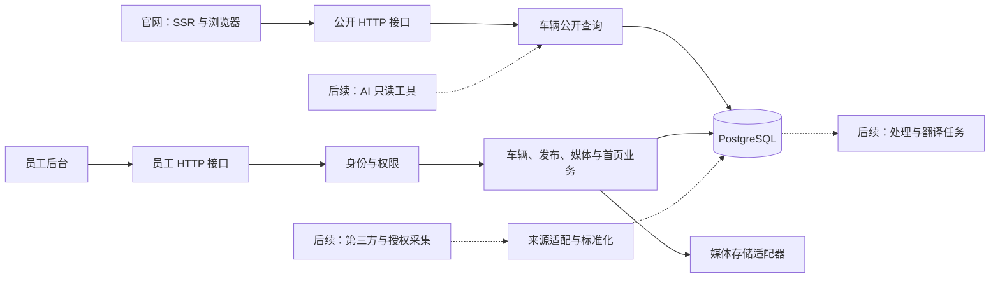

# 后端架构与分阶段实施

2026-11-08｜BE-ARCH-01｜状态：规范待验收，BE-01/02 本地服务实现已通过自测与独立审查、待 FE/AD 联调。本文也包含后续阶段设计；实际范围与证据见[后端任务书](../协作/后端.md)和[本轮日志](../日志/2026-11-08/后端-BE-01-02-基础与单车闭环.md)，不代表生产上线。

接口字段、路径、错误与发布条件只在[车辆接口](车辆接口.md)维护；产品顺序见[路线图](../../product/路线图.md)。本文维护技术选择、数据流和扩展边界，避免出现第二份接口契约。

## 1. 本轮范围与技术选择

本轮执行 BE-ARCH-01、BE-01 和 BE-02：建立可交接规范、独立 API、公共契约、员工身份与数据库，再实现一辆车的草稿、媒体、发布、公开读取和下架。官网运行时迁移由 FE-01 负责，员工界面由 AD-00/01 负责；后端测试通过不等于两端已联调或真实内容已验收。

| 层 | 选定方案 | 理由与落定方式 |
| --- | --- | --- |
| 运行时 | Node.js 24.19.0、TypeScript、pnpm workspace | 沿用仓库 `.nvmrc` 与工具链，应用独立声明依赖 |
| HTTP 服务 | Fastify 5，位于 `apps/api` | 保持独立服务与可测试的请求边界；不迁入官网路由 |
| 数据库 | PostgreSQL 18 | 事务维护发布、版本和审计，初期一个关系数据库 |
| 数据访问与迁移 | Drizzle | 数据库模型只在 API 内；迁移文件审查、版本化后执行 |
| 员工身份 | Better Auth | 使用库的身份、密码与会话机制；服务端补齐员工角色和业务权限 |
| 契约 | Zod 4，位于 `packages/contracts` | 同一 schema 形成运行时校验、推导类型和可检查接口资料 |
| 媒体 | 同服务器私有持久化目录，API 授权后由 Nginx 交付；规模增长后接对象存储 | 业务引用媒体 ID，不依赖本地路径或供应商 URL 结构 |

除已在仓库固定的 Node 外，依赖精确版本以各包清单和统一锁文件为准；数据库镜像固定补丁版本或摘要，不使用 `latest`。安装成功、构建成功和兼容性测试分别记录，不在本文预写通过结论。

初期保持一个模块化 API；异步任务出现时可由同一代码包启动独立 worker 进程。暂不引入微服务、Redis、搜索集群、独立消息集群或向量数据库。基础设施预算与服务器采购由现有路线图和运维任务维护。

## 2. 模块边界与数据流

- HTTP 层处理参数、身份、错误和响应；业务层决定发布、库存与版本；数据层负责查询、约束与事务。业务规则不写进前端，也不由数据库行直接生成公开响应。
- `@hd/contracts` 的公开与管理出口明确分开，均须浏览器安全；不包含数据库连接、供应商 SDK、会话秘密或 React。官网和后台通过 HTTP 调用 API，不导入 API 内部源码。
- API 内按身份、车辆、发布、媒体、首页和审计划分责任。未来来源接入、翻译和 AI 使用既有业务入口，不建立第二套库存与发布流程。
- 公开接口由允许字段构造 DTO；员工权限不改变公开 DTO 的内容。成本、完整 VIN、内部备注、来源联系人和原始数据始终不经过公开查询。
- 登录、员工操作与草稿使用 `no-store`。G1 精选公开查询也先 `no-store`，优先验证发布与下架立即可见；以后加缓存须明确失效和一致性验证。

## 3. 持久化、发布与运行

人工车辆、可编辑草稿、不可变发布快照、媒体引用、首页排序与审计由关系数据库维护。准确实体和约束随迁移落码；不为尚未实施的 CRM、AI 或采集系统预建空表。

- 车辆 ID 和询盘车号稳定，库存状态与发布状态分离。草稿编辑保留当前公开快照；发布事务生成新快照并更新指针、版本和审计，失败整体回滚。
- 库存变为已售立即退出可售列表与首页；下架撤销公开访问。旧草稿重新发布不能隐式恢复已售库存。首页查询仍核对实时发布与库存状态，不依赖一份可能过时的列表副本。
- 管理修改按版本检测冲突；创建、发布支持幂等请求。并发控制和唯一性由数据库约束与事务兜底，不能只靠页面按钮禁用。
- 金额、日期精度、来源时间和缺失值按车辆契约保存。内部成本、来源挂牌价、公开展示价与客户报价分开，不静默推算或补零。
- 媒体先私有上传、内容校验与处理，完成后才可用于发布；草稿预览检查员工身份。数据库保存媒体 ID、来源与存储定位，不保存图片二进制。引用保护和删除策略同时考虑发布历史。

开发库和测试库隔离，测试不得连接生产。构建不连接数据库；启动时校验必要配置。运行账户与迁移权限分开，迁移显式执行；需要破坏性变化时先准备兼容步骤和恢复方案。连接池、请求超时和任务并发都设上限，多个进程的连接数合计纳入预算。

本地端口、环境变量、登录路径及代理用法由 API 运行文档和车辆接口维护。生产采用 HTTPS 和约定代理，Cookie、Origin/CSRF、CORS 按实际域名验证，不能把开发同源视为部署证明。健康检查区分进程存活与数据库等必要依赖可用，避免在响应中暴露连接信息。

服务器发布、持久化存储、备份恢复和应用回滚属于 BE-03/OPS 联合验证；对象存储按实际规模后续接入，不作为首期服务器上线前提。备份必须覆盖精选、发布历史与媒体，第三方许可缓存单独设置保留规则；各轮真实部署与恢复证据按 OPS 日志核对。

### BE-INT-03：回收站与人工外部挂牌切片

本轮实现范围以[车辆接口第10节](车辆接口.md)和[BE日志](../日志/2026-11-08/后端-BE-INT-03-回收站与人工外部挂牌.md)核对。车辆逻辑删除与下架独立：删除标记、操作者及版本在 `vehicles` 保存，首页引用清理与审计同事务；按 `home_config → vehicles → media_assets` 顺序取锁。恢复清空当前发布指针和库存核验，保留不可变发布历史、草稿和媒体，不能自动回到线上。媒体清理重新取得车辆锁并复核删除状态，回收站数据不进入物理清理。

人工外部挂牌暂用固定“人工录入”获取方式，平台 ID 与平台内挂牌身份建立唯一约束，回收站也占用此身份。来源类型及身份创建后不变；第三方的事实、原文和当前译文作为草稿后显式发布，原文变化不能直接更新线上快照。对外库存保持待核实，价格明确为参考价或待询；不把已录入挂牌当作已接入自动来源适配器。未来多获取方式的 `provider + upstreamSource + externalId` 映射按后续阶段扩展，不能悄悄合并不同平台的相同数字ID。

媒体卷保留 UUID 相对文件名，公开缩略图固定240px WebP，按需从已处理展示图生成并保存在同一私有目录；缩略图权限完全复用有效发布引用。移交存储时保持相对文件名和数据库一致，不在数据库保存机器绝对路径。按用户后续决定，首期真实服务器采用 `MEDIA_DELIVERY=nginx`：API 授权并检查私有文件后返回固定 `X-Accel-Redirect`，Nginx 同 UID 只读挂载并仅在 internal 白名单位置发送文件。原生本地默认 direct。权限、撤销、no-store、文件竞态与未来对象存储边界以[车辆接口第12节](车辆接口.md)为唯一协议；此增量不等于真实服务器已上线。

## 4. 后续来源接入与自动翻译

以下是后续阶段设计，当前不连接真实第三方、不执行网站采集，也不调用翻译服务。BE-04 先接一家通过样本与使用条件验证的供应商；自采集作为 BE-INGEST-01 复用同一入库边界，一次实现一个明确来源。

### 来源进入数据库

来源适配器负责请求、额度、来源分页和字段转换；标准化流程负责校验、幂等入库与异常记录。API、授权网站采集和文件导入是不同获取方式，不能用导入方式替代真实来源身份。公共 `source.kind` 沿用人工/外部；内部保留获取方式、来源链接和解析版本。

- 来源三元组 `provider + upstreamSource + externalId` 唯一；同源重复抓取更新同一来源记录。跨源疑似同车只提供关联候选，不按车型或相似图片自动合并。
- 原始证据、标准化来源事实、人工精选与公开发布结果分层。原始数据只在允许范围保存，并记录保留期限；来源更新不得覆盖人工精选事实或员工编辑。
- 分开记录上游更新时间、抓取时间、库存人工核验时间和缓存到期时间。失败、超时或不完整分页不判定车辆已售；完整同步才处理缺失记录，明确撤车事件单独处理。
- 撤车、许可到期与删除要求覆盖来源数据、缓存、媒体和后续索引。关联精选仍保留来源关系与适用义务；备份采用相应到期策略，恢复后重新执行待生效的删除处理。
- 限流、超时、有限重试、请求/记录/详情计量按来源配置。抓取入口只使用已配置来源，限制主机和重定向，不提供任意 URL 下载代理。供应商故障不得阻断人工精选读取。

### 入库后翻译

BE-I18N-01 在来源原文成功入库后安排后台任务，页面请求不等待翻译。仅翻译标题、描述等展示文本；品牌/车型规范 ID、金额、单位、日期和枚举由结构化数据与词典处理，不让模型重写车辆事实。

- 任务关联来源记录、字段、目标语言、原文 hash 与翻译配置版本。原文文本变化产生新任务；仅价格、里程等结构化事实更新而文字未变时沿用有效译文，不重复翻译。
- 写回前再次核对原文 hash 和人工编辑版本；已过时的任务不能覆盖新原文或员工修订。人工版本优先，原文改变后标记需复核而非自动覆盖。
- 汽车术语表由后端统一维护并版本化：标准属性使用代码与中英俄词典，品牌/车型/配置优先规范名称，无法确认则保留原名。翻译供应商通过适配器接入，替换供应商不改变车辆事实或公开契约。
- 翻译输入只从可公开文本字段投影，输出同样按字段白名单校验；原始来源联系人、内部备注、凭据和任务失败详情不进入公开结果。来源文本是待处理数据，不能成为系统或工具指令。
- 自动校验核对译文与原文中的金额、日期、型号及必需术语，异常进入待处理列表。校验通过不代表语义完全正确，也不能把 machine 标成 human；人工可修正并复审。
- 员工精选按 BE-UX11 的新决定要求中英俄内容完整、对应当前原文且非 stale，再完成整体预览确认；不再逐字段要求 approved。机器结果先作为建议，员工统一保存后才能发布，machine/pending 不改成人审。外部市场目录保留来源语言与翻译状态。
- 目标语言必需标题未就绪时，车辆不进入该语言目录；可选描述未就绪时省略并提示。列表、总量与筛选字典使用相同语言可见条件，不用原文伪装目标语言译文。
- 公开响应只组合当前来源事实版本与原文 hash 一致的有效译文；文字未变时沿用的译文随新事实版本读取。已售、下架与来源撤回立即影响可见性，不等待翻译任务完成。
- 翻译失败返回明确状态；源记录删除或使用许可到期后取消任务并清理不再允许保留的衍生译文。
- 后续任务队列选定 PostgreSQL 支撑的 pg-boss，实际引入 worker 时核验兼容性并锁定版本。任务须支持幂等、有限重试、暂停、失败定位和人工重跑；任务可能重执行，处理过程须保持幂等。
- BE-03 建立可靠任务运行基础，BE-04/BE-I18N-01 再接入增量翻译。每个来源和供应商设批量大小、并发、超时、重试及费用上限；超过预算暂停并提示处理。读取页面只使用已保存结果，失败不回滚原始数据或阻塞库存更新。

## 5. AI 的公开数据读取边界

BE-AI-01 为后续任务。首期 AI 工具仅提供**已经允许公开的数据**：按条件查车、取公开详情、读取来源/更新时间与缺项。AI 即使由员工使用，也不因此获得管理权限；草稿、成本、员工信息、原始来源材料和完整 VIN 不进入工具结果。

- 首交付采用 HTTP 接口及 OpenAPI 通用工具定义，复用公开查询及其校验 schema，返回稳定车号、事实、数据时间和缺失项；MCP 如有实际消费者再另作适配，不复制查询逻辑。
- 模型不持有数据库账号、不执行任意 SQL、不直接写库，也不获得发布、上下架和真实消息权限。工具服务器的调用身份、查询预算与审计不能扩大结果字段范围。
- 车辆描述、第三方内容和译文都作为不可信数据处理，不能改变工具权限或执行规则。记录工具名、请求标识与必要操作证据，避免完整原始内容进入日志。
- 初期使用结构化筛选和品牌/车型别名。语义检索或向量索引由实测需求触发，且必须复查实时库存与发布状态；检索索引不成为库存真相。
- 工具测算、报价和对客 AI 另按后续阶段分配；计算规则不得由模型猜测。共享计算包只在真实第二消费者与提取任务明确后建立。

## 6. 分段交付与验收

| 阶段 | 交付 | 完成证据 |
| --- | --- | --- |
| BE-ARCH-01 | 本文、后端规范入口、角色任务与实施顺序 | 文档/链接/规范校验，独立审查；不代替代码验证 |
| BE-01 | 契约、API、员工身份、数据库迁移与本地运行 | 生产成品启动、迁移、身份/权限、契约安全出口与配置失败场景 |
| BE-02 | 单车草稿、媒体、发布、公开读取、库存和下架 | 事务、冲突、幂等、泄露与媒体校验；FE/AD 联调另登记 |
| BE-03 | 同服务器持久化与 Nginx 交付、可靠任务基础、监控与恢复；按规模接对象存储 | 引用清理、任务重试与恢复、监控、真实备份恢复与兼容回滚；引入缓存时验证失效 |
| BE-04 / BE-INGEST-01 | 一家供应商 / 一个自采集来源 | 样本映射、去重、撤车、异常、额度和保留策略 |
| BE-I18N-01 | 入库后异步翻译 | 重试、原文变更、人工覆盖保护、公开标记与删除传播 |
| BE-AI-01 | 公开数据的只读查询工具 | 权限、字段白名单、下架后不可读、参数边界与来源可追溯 |

每个阶段先完成自测，再由独立 Reviewer 审查，修复后复查；涉及两端的真实场景交 QA 联调，PM 核对证据，业务与视觉由用户确认。每轮更新[后端角色摘要](../协作/后端.md)和开发日志。Git 提交、推送、合并和部署分别记录；本规划不自动执行外部接入或生产操作。

## I18N02 / FEUX04 增量：公开展示与事实分离

此增量在员工明确触发翻译的范围内实施，不引入自动采集或后台worker。完整HTTP与schema规则见[车辆接口第14节](车辆接口.md#14-i18n02--feux04展示字段多语完整目录筛选与回执兼容)，不在此复制字段清单。

- 保持旧事实JSON和不可变发布JSON；新增草稿侧表保存代际/驱动的nullable事实、按身份绑定的展示字段、来源版本/人工版本及失效内容。新增不可变发布侧表同事务保存三语投影。发布差异比较包括侧表，库存即时状态不依赖侧表。
- 接入器仍仅获取原文/事实；展示译文只可由明确员工操作或未来可靠任务写入同一流程。名称词库与自由文字分开；生成输入只取服务端公开白名单，缺失语言声明为und，不能猜测语言或绕审核。
- 默认公开v1响应兼容旧消费者，新消费者显式view=localized；四类公开查询复用同一语言/发布可见性与投影。完整目录先SQL筛选后分页，金额以numeric比较原币值，未知值与已知0分开；范围不隐式换汇。
- 译文保留源绑定和人工修订。价格说明绑定整组内容/次序，图片绑定媒体ID，车型层级绑定稳定父ID；旧结果不得覆盖新源或人工内容。退役条目仍保存在内部侧表，当前公开响应不含源hash、引擎或内部资料。
- 新单车回执扩展元信息与旧持久化DTO分离，并以回执内容摘要防止错配，旧二进制可重放；迁移保留历史业务结果和有效期。新API与旧API对sidecar写入的理解不同，回退停止管理写入并切匹配消费者，不能把“能重放”扩展成“新流程任意写入都可回退”。
- 0003迁移是显式运行步骤，ready验证所需表；测试库与原生验收库严格分离。37项品牌词库只是首批覆盖；静态词库、字段支持能力、存量译文质量和实际运行启用分别验收。

## BE-EXT-01 隔离外部目录

外部自动挂牌采用独立写入链路。迁移0004追加原档／批次、来源挂牌、人工覆盖／事件、公开投影、媒体及试译账本。员工管理的草稿、审核和不可变发布仍通过原服务。公共读取合并两条已公开的流，接口、来源校验和消费者约定见[车辆接口第15节](车辆接口.md#15-be-ext-01-外部挂牌与试译干跑)。

- 批次事务先锁定隔离导入写入顺序，再按来源三元组和 revision 应用候选，存储原档、行状态与当前投影。重复请求复用永久批次回执。员工的结构化修订和语言修订与来源分开，使用挂牌版本控制并发，来源变化只使失效的译文退出公开投影。变更可见数据时同步递增外部目录版本。
- 公开读侧按共同条件和同一数据库快照处理员工／自动挂牌两组。挂牌规范事实只存一份，公开投影存一份有效事实及各语言文字。列表不读原始响应、完整规格或检测报告；价格、车型、能源、里程、年款及排序列已具备索引。外部图片同一来源媒体 ID 持续保存，刷新提示按图片版本去重，供应商故障与撤回分别处理。
- 试译计划固定批次内100个已归档挂牌及其内容身份。预留、派发记账和尝试关闭分开，PostgreSQL 锁与约束同时控制批次和账户月份。派发失败保留可能发生的全部用量；月界限按北京时间，过期核验不能继续派发。本阶段只开放干跑，无已核验账户余额或实际调用，官方计费口径见[阿里云中国站](https://help.aliyun.com/zh/machine-translation/product-overview/billing-overview)。
- 离线 ChinaCarAPI 样本适配检查 PA 已核验文件摘要、试译与对照名单、封装原文和语言对应。保存每条原始行和配套证据后统一应用导入流程。供应商的两组价格分别保留，显示只取无争议的 `price.cny`；年款、登记日期与实际制造日期各自处理，估算的制造区间留在原档。样本 CDN 的签名参数与到期时间按确切主机和参数解释。HTTP 导入端只允许合成 profile，离线样本命令使用新建随机库并在完成后清理。

## BE-EXT-02 目录容量、同步与美元投影

- 迁移0005将目录事实、搜索和筛选搬到索引与 SQL 聚合。搜索扩展使用 `pg_trgm`，迁移环境须具备安装权限。员工和外部车源保持各自排序，通过有限页结果合并。游标绑定公共目录版本和过滤条件，同时间戳仍按 UUID 可重复地定位。常用价格条件在原币索引上查找，无需逐车计算汇率。
- 迁移0006建立共用 `epoch/revision`。公开可见性变更在业务事务提交时推进一次。事务保留延迟触发器的默认约束行为；从旧备份恢复后，在开放读取前更换 epoch。每进程最多64个内存项、16 MiB；Redis 最多64槽、单槽最多1 MiB，TTL 不超过30秒且不跨媒体与汇率到期点。Redis 只共享完成的结果，单飞和并发上限按 API 实例计算。缺失版本时拒绝回传旧结果。
- 迁移0007支持独立的合成同步 worker。增量与完整校对周期分别为5分钟和7天；短租约与 fencing token、检查点、导入回执在同一事务完成。有限重试和显式撤回优先；不完整批次不推断撤回。图片信号按当前版本执行，失效版本退出。进程有独立连接池，收到停止信号后结束当前工作并关闭。
- 迁移0008的模拟试译使用固定100条记录。真实试译账本的预留、派发和结算保持分开。中断派发保留已记账用量，模拟输出只进入隔离模拟结果，不进入公开投影。试译恢复与同步 worker 都不使用外部供应商。
- 美元视图只处理已公开原始金额。迁移0009和0010增加汇率快照与价格索引；一个快照在查询事务内统一用于展示、计数、筛选和游标。后端以整数分及有界十进制定点汇率计算，按展示值的半分边界反推原币区间。汇率刷新不改车辆原始价格、不重写整个目录；缓存键会随有效快照切换，过期时也会自动失效。实时页面读取只访问数据库和有限缓存。[汇率来源与署名规则](https://www.exchangerate-api.com/docs/free)

- 迁移0011维护外部挂牌的窄查询投影。来源公开状态、来源时间和目录可见性在同一窄记录上协调，版本在事务提交时更新。列表先定位有限 ID，再读取完整展示内容。筛选先合并相同维度组合，仍对每个选项返回精确数量。迁移0012收集组合字段的分组统计，避免优化器把常用筛选估成大量分组并落盘排序。
- 登录另使用内存有界的账号键限频。管理上传写入及普通翻译建议按精确路由分别计数。公开读侧继续使用可信访客 IP 和既有预算。[限流与重试契约](车辆接口.md#11-be-int-03-分桶限流与可信访客-ip)

接口与边界见[车辆接口第16节](车辆接口.md#16-be-ext-02-目录容量与美元展示)。外部实时供应商、真实 CSV 增量规范与付费翻译仍待来源接入阶段。

## BE-ADUX10 发布检查与私有预览

迁移0014给员工车辆添加独立的 `public_content_revision`，并保存每辆车、每名员工的当前确认。车辆管理版本继续处理所有编辑冲突；公开草稿版本只随公开字段、展示翻译、引用媒体及库存／下架／退回草稿／删除状态变化递增。内部成本和备注变化不递增，正常发布、发布指针与发布时间也不递增；A→B→A仍产生更大的公开版本。下架后重新发布必须重新预览确认，旧成功key只重放原回执，不改变当前下架状态。现有不可变发布数据不回填、不下架。

确认显式携带用户已见的版本、公开内容版本、语言和投影指纹。指纹覆盖当前公开事实、文字及审核状态、媒体和真实美元展示。服务先锁员工与车辆，再读当前子表；图片须可从私有存储读取。预览／确认／发布共用一套准备与检查函数。发布在同一事务中重查员工权限、草稿版本、必填信息、三语就绪条件（BE-UX11 替代旧逐字段审核）、当前员工确认及其有效期。媒体准备或锁等待可能跨过确认／汇率时限，因此最终确认按实际数据库时钟重查，汇率同时核对当前生效与到期时刻。汇率写者和发布者使用同一既有 advisory 锁，避免检查后被另一报价切换。公开查询继续使用原有事务快照时钟。

人工车与员工维护的 external 副本都受新必填／三语／预览门槛；外部副本保留参考价和未知库存。自动外部表仍走既有来源同步，不受员工发布流程影响。外部副本内部译文审核状态如实出现在鉴权预览，现有公开 external `reviewed=false` 兼容语义保持不变。内部成本是发布条件，永不进入预览或公开 DTO，也不触发翻译。单独价格／库存变化只使预览失效，不重译未变的文字。

预览用独立严格白名单 DTO，容纳缺失价格、文字和图片以及 pending/stale 状态；已满足审核的命名属性、图片说明与报价说明使用和正式 localized 接口相同的语言投影。官网只提供空壳与同源鉴权读取，后台接收当前 iframe 完成证明后由员工显式确认。浏览器消息协议和唯一接口形状见[车辆接口第17节](车辆接口.md#17-be-adux10-发布检查与私有预览)，不在角色规范复制第二份定义。

## BE-UX11 配置、统一翻译与来源报告

此增量遵循[接口第18节](车辆接口.md#18-be-ux11-配置多语工作区与真实历史)，API 实现与运行切换分开验收。配置保存一份严格解析后的事实对象，公开详情和私有预览共享投影；列表和首页不携带配置。空草稿可保存，员工发布必须有配置。旧客户端遗漏字段保留值，明确 null 清空；已发布快照不追溯改写。

正文和展示字段在统一工作区事务中保存，锁定员工、车辆及双方版本，末尾审计失败整体回滚。中文源标题以用户基础输入为准，不从车型拼接；新字段为中文，历史 und／地区语言及缺少侧表的字段不会因普通保存被改成中文。历史语言确认仅在统一工作区显式执行。原文变化使旧英俄内容过期，人工文本保留；发布允许当前完整的 pending 内容，真实来源和审核状态继续投影。

迁移 0015 保存十分钟翻译计划和逐目标分段结果。计划仅估算服务端公开文本，执行要求一次范围／未知费用确认。短事务先登记派发，外呼期间不持有车辆锁；执行后先保存段结果，再检查源版本。成功段可复用，派发中断按结果未知处理；状态 GET 只读重建结果，不能引发重试。失败或未知段需新确认才重新尝试，原成功回执保持可读取。并发、小时字符上限和聚合超时由既有翻译适配器约束，当前上限在单 API 进程内计算；扩成多副本前须迁入共享预算账本，不能把进程内额度当供应商余额。这不是通用后台 worker 或已核实免费额度。

迁移 0016 保存绑定来源身份、版本和摘要的离线检测补充与内部报告核验记录。补充投影不重写原始来源，不用检测缺陷数推导事故次数。按用户后续决定，公开只提供“来源有报告”的事实给联系销售提示；原始报告 URL 仅在鉴权后台使用既有安全规则、同车来源绑定后返回，访问核验结果不再是展示前置。公开和预览无报告 URL，GET 不访问报告网站。导入和核验资料的实际准备状态另记，不能用样例宣布已接入。

升级时显式迁移 0015／0016，再配套切换 API、AD 与 FE。旧两条建议接口只重放历史成功结果，新调用必须走确认流程。旧 API 不理解配置、统一工作区和新来源语言语义；回退先停写并评估新数据，不能只换二进制继续写。构建、隔离数据库验证、三端联调和 3363 切换分别记录。
