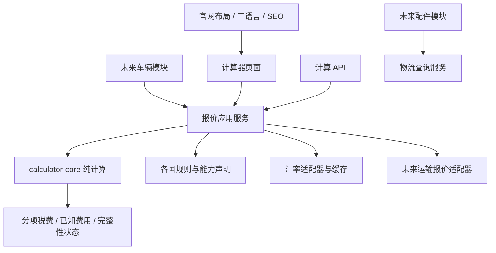

# 二手车综合官网：产品与开发交接规划

版本：v1.4｜需求确认与参考调研日期：2026-10-22｜费用详情折叠与复制部署决策更新：2026-10-24｜交付对象：后续开发 Agent

本文是开发任务书，不是已经实现的网站。配套阅读：[计算器参考规则研究](./计算器参考规则研究.md)。

2026-10-23 P1.4：按用户反馈已把七国参考金额、RU纯电/完整回收费、UZ新旧车及KG个人/企业全部接入。实际交付与验证见[开发进度](./开发进度.md)及[规则覆盖表](./规则覆盖表.md)；后续重点为官方规则、资格及落地成本，而非再把这五国写成未接通金额。

2026-10-23 P1.5：用户要求逐项说明具体怎样计算，同时保留代入公式；结果框右上角加入随车辆年份等条件变化的圆形印章，并在顶部加入公司 Logo 淡水印。已按七国三语言接入主费用、额外估算及复制结果。方法由国家策略提供实际分支和参数，印章只说明参考分类，不代替政策核验；金额内核不因本次展示改动而变化。维护位置见[实际技术架构](./技术架构.md)。

2026-10-23 P1.6：已完成现有功能与模块边界复查，将草稿恢复、复制参数选择提取为纯应用函数，增加自动依赖边界保护；修复直接调用时的异常日期类型和 API 流式字节限制。生产 standalone 包在 Node 24.19.0 本机通过完整浏览器验收，补齐最终水印截图。部署文件与[Linux 服务器步骤](./服务器部署.md)已准备；未连接实际服务器，不将本地通过写成 Linux／HTTPS 已部署。后续车辆模块仍只通过公共计算入口传显式事实，不依赖计算器表单、草稿或内部策略。

2026-10-24 P1.7：用户确认采用纯静态部署，并提供Ubuntu22美国VPS已装s-ui作VPN。当前改为Next export，21国家语言页和入口／404／SEO均为静态，计算仍在浏览器；服务器不部署Node应用或公开计算API。日期浏览器初始化、汇率明确构建快照并保留手工调整。HTTP适配器只留源码供后端未来独立部署。部署须先核对现有VPN的TCP／UDP端口，Nginx标准80/443或确认空闲的备用8088/8443，不替换VPN入口、不重置防火墙。Mac构建out可直接上传Ubuntu；旧standalone／systemd网站方案不再采用。完整步骤以最新[服务器部署](./服务器部署.md)为准，以上旧阶段只作历史记录。

## 1. 已确认的产品方向

2026-10-24 P1.8：用户明确授权连接其美国 Ubuntu22 VPS 部署，暂时无域名，按 IP 试运行。已备份 s-ui 数据库和服务配置，在空闲 TCP80 新装 Nginx 提供静态网站；原 s-ui 继续监听 TCP443。构建 origin 使用实际 HTTP IP 且保持 noindex。具体发布版本、备份、保留边界及公网验收见 [VPS-IP部署记录](./VPS-IP部署记录.md) 和 [开发进度](./开发进度.md)；不能把 IP 试运行解释成 HTTPS／SEO／官方规则核验已经完成。

2026-10-24 P1.9：按用户反馈缩短价格结果框，每笔主费用和额外费用的具体计算说明、代入公式默认收起；独立 `ui/fee-line.tsx` 支持单项展开，顶部可全部展开／收起，本币与 USD 金额始终可见。已展开详情随参数即时重算，恢复默认或切国家重新收起；复制摘要仍包含所有说明与公式。三语 `FeeDisplay` 增加 4 个操作 key，运行时各 420 key，基础 JSON 各 248 不变。金额内核、规则版本和官方核验范围未变。

本轮已在公网 HTTP 复现 `isSecureContext=false`、`navigator.clipboard` 不可用，确定复制失败原因。用户明确选择不增加兼容，之后自行部署 HTTPS；保留原标准 Clipboard API 实现，没有 HTTP 回退文件或新依赖。不要将费用折叠改动解释为 HTTP 复制已修复。本机类型、5 项边界、626 单元、export 构建和最终完整 101 项浏览器验收通过；首次唯一失败是 `innerText`／`textContent` 断言口径，修正后重新全量通过。网站更新沿用静态 release、旧哈希保留及原子切换，保护 Nginx／VPN 配置和防火墙；线上实际结果继续以 [开发进度](./开发进度.md) 与 [VPS-IP部署记录](./VPS-IP部署记录.md) 为准。

建设面向中国汽车出口业务的综合官网。一套响应式网站覆盖 PC 与手机浏览器（H5），支持简体中文、英语、俄语，具备可被搜索引擎读取的内容与独立语言地址。

长期包含三个业务模块：

1. **汽车**：选车、车辆详情、自有车源；未来通过适配器接入外部平台车源。
2. **汽车配件**：配件展示与后续零售交易；物流状态查询是配套能力。
3. **计算器**：按目的国、进口身份及车辆条件计算进口费用；作为独立函数供将来的车辆详情、报价等功能调用。

首期只完整开发计算器及其必需的官网基础。视觉、信息层级、国家切换、输入后即时显示费用明细等交互，参考 [K-Axis 计算器](https://www.kmotors.shop/en/calculator)。使用自己的品牌、文案和资产。

### 已确认的首期范围

| 决策         | 要求                                                                                                       |
| ------------ | ---------------------------------------------------------------------------------------------------------- |
| 出口来源     | 中国；不能把“从中国出口”等同于“原产国为中国”                                                               |
| 目的国       | 俄罗斯 RU、哈萨克斯坦 KZ、乌兹别克斯坦 UZ、格鲁吉亚 GE、亚美尼亚 AM、吉尔吉斯斯坦 KG、阿尔巴尼亚 AL        |
| 进口身份     | 业务保留个人、企业；首期页面按参考站，仅 KG 显示两种类型切换，其他国家不展示此选项；用途和优惠资格另行判断 |
| 语言         | `zh`（简体中文）、`en`、`ru`                                                                               |
| 设备         | PC 与 H5 共用一套业务逻辑和路由                                                                            |
| 核心复用目标 | 车辆数据 → 公共计算接口 → 进口费用及具备完整条件时的落地成本                                               |
| 后续扩展     | 新国家、新语言、新车源供应商、新运输报价来源                                                               |

格鲁吉亚按用户后续补充的链接纳入首期，最终为七国。长期能力仍按 **7 国 × 2 类进口身份** 登记覆盖状态，但按 2026-10-23 最新要求，前台参考工具仅在参考站有身份切换的 KG 显示该选项，其余国家使用其参考口径；没有选项不代表两类身份的法定规则相同。

### 本规划采用的默认决策

这些是为便于直接开发给出的默认方案，不是用户已提供的业务事实：

- 英语作为根路径的默认跳转语言；明确的 `/zh`、`/en`、`/ru` 地址始终可访问。语言选择记忆不改变已访问页面的语言地址。
- 不要求用户注册即可使用；首期不做会员、支付、订单、运营后台或爬虫。
- 车辆类别首期按参考工具限定为 M1 乘用车；货车、客车、摩托车和特殊用途车辆列为后续范围。这是默认实施边界，不是用户已逐项确认的车辆分类。
- 税率、国家字段和费用配置先用版本管理的文件维护；汇率通过服务端适配器获取、缓存。
- 品牌确认为 **HD Auto Export**，使用用户提供的黑金 Logo；Facebook 为 `https://www.facebook.com/HDAuto`，WhatsApp/Instagram/Telegram/WeChat 号码均为 `18215932610`。电话/WhatsApp 按中国区号 +86 接入，其他渠道未确认用户名时提供号码复制。域名尚未提供；全部集中配置，不使用参考站联系方式。
- 首页先做简洁品牌介绍与计算器入口。车辆、配件尚未开放时不展示可点击的空页面。
- 首期可提供复制计算摘要、重置输入；账户历史、服务器保存报价、PDF 报价单、在线咨询表单放到后续。若没有实际联系方式，不放无效咨询按钮。

## 2. 首期交付与未来边界

| 范围         | 首期必须交付                                                          | 后续扩展                             |
| ------------ | --------------------------------------------------------------------- | ------------------------------------ |
| 官网公共部分 | 响应式导航与页脚、三语言、基础品牌页、404/错误状态、基础 SEO          | 关于我们、指南、内容管理             |
| 计算器       | 7 国入口、个人/企业条件、动态字段、费用明细、来源与日期说明、输入校验 | 比价、批量计算、保存与导出报价       |
| 计算能力     | 独立税费函数、落地成本组合函数、版本化规则、同一核心的服务端接口      | 运输报价服务、车辆自动估价、规则后台 |
| 汽车         | 公共车辆事实类型、未来接入示例与模块边界                              | 自有库存、搜索筛选、外部平台适配器   |
| 配件与物流   | 预留路径、模块职责、适配器契约文档                                    | 配件目录、订单、支付、快递/货运查询  |

不为“预留”开发空商城或复杂后台。未来业务模块通过公开接口接入，不允许直接读取其他模块内部表或组件状态。

**功能目标与上线门槛必须区分**：按最新用户反馈，首期前台选项和政策说明参考该站；只有 KG 显示个人／企业切换，未接通规则保持待确认，不为其他国家增加参考站没有的身份选择。长期覆盖表仍分别登记两类身份；只有完成相应规则核验与验收，才能宣称组合可用，不能用“前台无选择器”推断企业已支持。

## 3. 技术架构建议

采用 **一个可部署的网站 + 按业务分开的模块 + 独立计算内核**。首期不拆微服务，不要求多仓库。

建议技术组合：Next.js App Router、TypeScript、next-intl；样式使用 Tailwind CSS 或统一的 CSS 变量体系；金额运算使用十进制运算库；核心测试使用 Vitest，页面验收使用 Playwright。开发时核对兼容的稳定版本并锁定依赖，不使用未验证的 canary 版本。

选择这一方案的原因是：公共内容可以由服务端生成 HTML，输入和即时结果采用客户端交互；语言路径与页面元信息集中维护。依据见 [Next.js 服务端与客户端组件](https://nextjs.org/docs/app/getting-started/server-and-client-components)、[Next.js metadata](https://nextjs.org/docs/app/api-reference/functions/generate-metadata)、[next-intl 路由](https://next-intl.dev/docs/routing/setup)。



推荐目录；这是组织方式，不要求先建空文件：

```text
src/
  app/[locale]/                 页面、布局、metadata
  app/api/v1/calculations/      服务端计算入口
  modules/calculator/
    ui/                        表单、费用明细、移动端交互
    application/               参数规范化、快照装配、能力检查
    core/                      纯函数、金额、费用账目与结果类型
    policies/{ru,kz,uz,ge,am,kg,al}/
                               国家策略、数据、资格、测试样例
    infrastructure/            汇率/规则读取适配器
    index.ts                   供其他模块调用的公共出口
  modules/vehicles/            后续实现
  modules/parts/               后续实现
  modules/logistics/           后续实现
  shared/ui/                  通用视觉组件
  shared/config/              品牌、功能开关、站点域名
  i18n/                       路由与翻译加载
  messages/{zh,en,ru}/         按模块组织翻译
docs/                         本规划、规则登记、接入与维护说明
```

依赖方向：页面 → 应用服务 → 计算内核。规则数据和基础设施通过参数注入，内核不得依赖 React、Next.js、浏览器、数据库或任何网络请求。若以后单独发布计算 SDK，再抽出包；首期不必引入复杂 monorepo。

首期无需数据库即可工作；当前规则包随部署发布，服务端汇率缓存由部署平台或外部 KV 承担。不要把无状态容器的内存或本地磁盘当作持久报价历史。以后增加车辆库存、订单、询价记录时再引入数据库，并按模块拥有数据。

## 4. 页面与交互规划

### 页面地址

- `/{locale}`：简洁官网首页，突出业务定位与计算器入口。
- `/{locale}/calculator`：国家选择入口。
- `/{locale}/calculator/{countrySlug}`：国家独立页面，例如 `/zh/calculator/russia`。
- 后续保留 `/{locale}/cars`、`/{locale}/cars/{slug}`、`/{locale}/parts`、`/{locale}/tracking`，首期不开空索引页。

七个国家 slug 使用 `russia`、`kazakhstan`、`uzbekistan`、`georgia`、`armenia`、`kyrgyzstan`、`albania`。locale、国家代码和 slug 映射集中定义。

### PC 页面

```text
品牌 / 导航                                      语言切换
国家切换：俄罗斯 | 哈萨克斯坦 | ... | 阿尔巴尼亚
标题：中国出口至 [国家] 的汽车进口费用计算
范围提示：所选身份、计算日期、预计税费

┌ 输入卡片 ──────────────────┐ ┌ 结果卡片 ─────────────────┐
│ 个人 / 企业、进口用途       │ │ 车辆摘要、目的国           │
│ 车价、交易币种              │ │ 各项费用 + 计算依据         │
│ 车辆能源、排量、功率        │ │ 进口费用合计（范围明确）     │
│ 生产日期、其他国家字段       │ │ 另一展示币种的参考金额       │
│ 运输/保险（该国需要时）      │ │ 未包含项 / 待补齐项          │
│ 高级：计税日期、汇率等       │ │ 复制摘要 / 重置              │
└────────────────────────────┘ └──────────────────────────┘
费用说明、有效规则日期、常见问题、联系信息（有真实配置时）
```

- 大屏双栏，建议输入约 52%、结果约 48%；内容最大宽度约 1200px。
- 结果卡片适度吸顶；屏幕较矮或结果过长时恢复正常滚动，避免内容不可达。
- 更改完整有效输入后即时重算；不要求每次点按钮，不刷新整页、不跳动滚动位置。
- 按 2026-10-23 最新反馈，高级字段和汇率默认展开，允许手动收起；首次打开、切国家/语言与恢复默认均展开。
- 费用明细与合计同时显示目的国货币及 USD 参考换算，复制摘要和 H5 底栏同步；展示换算与法定税费计算分离。
- 合计下方保留参考站式国家政策与费用说明，按动力、车龄、舵位和可用身份切换相关内容。即使当前国家暂不提供金额，也可查看说明。所有内容中英俄一致，参考来源链接指向当前国家；中国出口语境不沿用韩国路线文案或报价。

### H5 页面

- 单列输入 → 结果；国家列表可横向滚动或使用底部选择面板，当前项必须清晰可见。
- 输入区合理分组，触控目标至少约 44px；数字输入提供合适键盘，单位不可仅放在 placeholder。
- 底部可用紧凑的“查看结果”条展示当前合计；结果未完整时显示“补全信息”，不保留旧合计伪装当前结果。
- 尊重安全区；软键盘打开时避免底部条遮挡输入框和错误提示；点击查看结果滚动到结果标题。
- 不依赖 hover；帮助内容通过点击、展开及键盘同样可访问。

### 输入与状态

- 国家决定字段，不做一张显示所有国家全部字段的大表。个人/企业、用途和能源决定进一步条件。
- 中国站交易币种首期提供 CNY、USD，默认 CNY。法定税费以目的国币种显示，并可提供 CNY/USD 参考换算；EUR 用于需要的法定税率换算。格鲁吉亚等规则若不使用车价，不为统一表单强制展示无用字段。KRW 不作为首期默认交易币种。
- 按 2026-10-23 用户反馈改为**默认预填**：车价 180000 CNY、排量 1998cc、功率 150hp、制造日期 2021-01、个人汽油、当前清关日期与自动参考汇率。提示可直接修改；不把默认车辆当用户真实车源。无需先点击载入示例。
- 常用字段只展示车价、排量、适用功率、制造日期和燃油/混动/纯电三类选择。进口身份、细分动力、清关日、汇率、舵位、运保费归入默认展开的更多设置；运保未报价不擅填数值。恢复默认重新填好所有已知默认项，而非清空表单。
- 输入未完成、格式错误、汇率读取中、汇率不可用、规则待核验、不支持情形、部分结果、结果完整均有独立状态。
- 换国家保留可迁移的原始事实（车价及币种、车辆数据），重新验证国家字段并重置不适用条件；不携带隐藏字段影响新结果。
- 换语言保留全部计算状态且金额不变；换展示币种只换算展示，不改变法定税费；换交易币种不能只改币种标签，应让用户确认金额或明确换算。
- 清空输入后不得用 JavaScript 的空值转换把它当作 0；功率、车龄精度等关键数据缺失时按国家规则提示或标记估算。
- 不记录每次键入；可用 150–250ms 的短防抖抑制频繁更新。结果变化通过克制的提示和无障碍播报告知，不逐键朗读所有金额。

### 视觉方向

目标是高级、简洁、顺滑，视觉复杂度服务于清楚理解金额。布局和交互尽量贴近参考站，具体色值与字体由实施 Agent 实际观察 PC/H5 后建立视觉基线，本轮未完成浏览器截图比对。

公开样式线索显示参考计算器使用暗色面板、细边框与等宽数字。保留其信息层次，品牌强调色按用户 HD Logo 改为**金色**：黑色背景、分层深灰卡片、清晰浅色文字。压缩首屏标题与说明，移除多余流程介绍；金额和关键输入优先，更多设置默认展开且可收起。不要堆叠汽车大图、3D 场景或持续粒子动画；首期不必额外实现明暗主题切换。

动效建议 160–240ms：国家指示器、分段选择、卡片展开、结果更新。金额真实值立即更新，视觉补间不得让读屏器读到中间错误金额。尊重 `prefers-reduced-motion`，输入焦点、错误提示和加载状态不能只依赖颜色。

## 5. 计算系统：先定义费用含义，再实现函数

参考站不同国家的“Total payable”包含项目不一致。不得统一把它解释成“最终落地价”。

### 分开三个概念

1. **完税价格/税基**：用来计算税费的中间值，可能包含采购价、某段运输、保险或经海关调整的估值；不能再次当作一笔费用加入合计。
2. **进口应付费用**：按明确范围合计关税、进口 VAT、回收/环境费用、注册等，地方服务费与官方费用分类显示。每国页面必须写明包含项。
3. **落地成本**：采购、运输、保险、出口服务、进口费用及目的地交付等实际成本项目去重后的合计；仅当选定交付范围的必需项目完整时才能给出。

首期页面仍以原站式的进口费用工具为主，不强行增加庞大的报价流程。但首期就实现并测试落地成本组合函数，使车辆模块未来可以传入车价与物流服务费用获得完整结果。费用未知时返回缺失项与已知小计，不默认填零。

企业场景的“进口现金支出”“可能可抵扣 VAT”“抵扣后的成本”不是同一个结果。首期默认显示实际需支付费用；只有明确的有效政策与资格支持时才另外给出可抵扣信息，不直接从落地现金成本里扣除。

### 公共契约草案

以下是语义契约，开发 Agent 可细化名称，但不得删除费用范围、版本、完整性或日期等信息。

```ts
type Money = { amount: string; currency: string }; // 十进制字符串；币种须校验
type Destination = 'RU' | 'KZ' | 'UZ' | 'GE' | 'AM' | 'KG' | 'AL';
type ImporterType = 'individual' | 'company';
type DeliveryScope = 'arrival_port' | 'customs_cleared' | 'registered' | 'door_delivery';
type DateFact =
  | { precision: 'day'; value: string }   // YYYY-MM-DD
  | { precision: 'month'; value: string } // YYYY-MM
  | { precision: 'year'; value: string }; // YYYY

interface VehicleFacts {
  category: 'M1'; // 首期乘用车；其他类别显式 unsupported
  originCountry?: string; // 真实原产国，未知则保留未知
  manufactureDate?: DateFact;
  firstRegistrationDate?: string;
  registrationStatus?: 'never_registered' | 'registered';
  powertrain: 'petrol' | 'diesel' | 'hev' | 'phev' | 'erev' | 'bev';
  displacementCc?: number;
  power?: { value: string; unit: 'kW' | 'hp'; standard?: string };
  // 国家特定数据另外由有类型、有校验的 policy input 提供
}

interface CostItem {
  id: string;                  // 稳定唯一标识，防重复
  kind: string;                // freight / insurance / service 等受控值，不含购车款
  amount: Money | null;        // 未报价不是零
  status: 'quoted' | 'estimated' | 'unknown';
  routeSegment?: string;       // 起点、边境段、终点等引用
  includesCostIds?: string[];  // 套餐覆盖哪些费用，不能重复加总
}

interface CalculationInput {
  exportCountry: 'CN';
  destinationCountry: Destination;
  importerType: ImporterType;
  importPurpose: 'personal_use' | 'commercial';
  customsDate: string;         // 预计清关日期，不是浏览器当前时间
  vehicle: VehicleFacts;
  purchasePrice?: Money;       // 税费不依赖车价时可缺；落地成本调用必须有
  purchaseCoversCostIds?: string[]; // 采购报价已经包含的运费/服务等标准费用 ID
  additionalCosts: CostItem[];
  destinationPoint?: string;
  deliveryScope?: DeliveryScope; // 落地成本调用必须显式指定
  displayCurrency: string;
  policyInput: CountrySpecificInput; // 按国家的联合类型，禁止 any 大杂烩
}

interface CalculationContext {
  rulesSnapshot: RuleSetSnapshot;
  customsFxSnapshot: FxSnapshot; // 法定计税换算
  displayFxSnapshot: FxSnapshot; // 参考展示换算
  calculatedAt: string;          // 显式注入，便于复算
}

interface FeeLine {
  id: string;
  kind: 'duty' | 'vat' | 'excise' | 'recycling' | 'registration' | 'service' | 'other';
  amount: Money;
  quality: 'rule_based' | 'estimated';
  dependsOnEstimatedInputs: boolean;
  includedInImportTotal: boolean;
  includedInLandedTotal: boolean;
  basisIds: string[];           // 对应税基/费用，不以翻译文本作为引用
  formulaId: string;
  explanation: { key: string; params: Record<string, string | number> };
}

interface CalculationResult {
  status: 'complete' | 'partial' | 'unsupported' | 'invalid' | 'needs_review';
  inputSnapshot: CalculationInput;
  feeLines: FeeLine[];
  taxBases: TaxBase[];          // 与实际应付费用分离
  totals: {
    importPayments: Money | null;
    knownCostsSubtotal: Money | null;
    landedCost: Money | null;
  };
  coverage: { importPaymentsComplete: boolean; landedCostComplete: boolean };
  missingFields: string[];
  requiredCostIds: string[];
  missingCostIds: string[];
  notApplicableCostIds: string[];
  excludedCostIds: string[];
  calculationQuality: 'rule_based_estimate' | 'mixed_estimate' | 'unavailable';
  assumptions: Array<{ code: string; affectedCostIds: string[] }>;
  warnings: Array<{ code: string; params?: Record<string, string | number> }>;
  evidence: { ruleVersion: string; fxSnapshotIds: string[]; calculatedAt: string };
}

calculateImportPayments(input, context): CalculationResult;
composeLandedCost(input, importResult, context): CalculationResult;
calculateLandedCost(input, context): CalculationResult; // 上述两步的便利入口
```

`CountrySpecificInput`、`RuleSetSnapshot`、`FxSnapshot`、`TaxBase` 在实现时补齐强类型；这是接口设计，不是可以原样编译的 SDK。共享字段不等于各国都强制使用所有字段，必要性由国家策略验证。

`status` 描述调用所请求范围的完整性；`coverage` 分别描述税费和落地成本是否齐全。税费已算全但未提供物流报价时，税费可以显示完整，落地总额必须为 `null`。总额展示币种统一，明细同时保存原始法定币种；不允许把不同币种直接相加。

落地成本入口需要更严格的 `LandedCostInput`：明确采购价、交付范围及该范围要求的目的地。由国家/路线/交付范围的费用清单生成 `requiredCostIds`，不能仅检查用户已传入项目就认定完整。费用需逐项为已知或有依据的不适用；存在 `missingCostIds` 时不得返回完整落地价。

采购价统一映射为费用账目的保留 ID `vehicle.purchase`，`additionalCosts` 禁止再次传入购车款。费用类型、运输区段、覆盖范围共同构成语义唯一键，`purchaseCoversCostIds` 与套餐覆盖引用同一套标准费用 ID；同一税费也使用国家策略生成的固定 ID。即使两笔费用 ID 不同，只要覆盖同一成本，也须报冲突或显式拆分覆盖，不能重复计入。

`complete` 只表示选定费用范围覆盖完整，不代表最终结算保证。手工汇率、估算运费或规则允许的日期补足必须通过 `assumptions` 传递到受影响的税项与合计，界面相应显示“预计”。采购价或日期未知时只在实际需要它的国家/功能阻止计算。

### 必须遵守的计算约束

- 内核不调用 `Date.now()`、不联网、无随机数、不读本地存储；相同输入、规则、汇率、时间快照必须给出相同结果。
- 国家策略分别声明必填条件、资格判断、税基组成、分档、舍入和不支持情形。不能用统一百分比覆盖所有国家。
- 生产日期、首次登记日期、车辆新旧、制造年份不可相互替代。日期不完整时按经核验的国家规则处理或提示，不统一补为 1 月 1 日。
- 出口国、原产国、目的国、海关进入国/路径不能混为一谈。首期可限定中国直达目的国；转口、第三国清关等情形显式不支持，未来增加路线模型。
- 个人身份不自动满足自用优惠；按国家要求提供进口频次、用途、持有期限等条件，缺少资格证据不能默认为享受优惠。
- 发动机功率需要单位和规则适用的功率口径，不能把内燃机功率、系统总功率或电机功率无条件互换。HEV/PHEV/EREV 不靠车型名称猜分类。
- 法定计税汇率与市场显示汇率分开。用户手工覆盖时记录来源为手工、日期和影响范围，并显示为估算。
- 汇率记录币种对、报价方向、计价单位 `nominal`、数据日、来源、抓取时间。禁止忽略“每 100 单位货币”的标价。
- 数值用十进制运算，舍入步骤和精度由规则指定；不要所有中间结果一律保留两位小数。
- 运费进入税基不代表重复付一次运费。采购价/运费套餐覆盖范围需明确，重复 `CostItem.id` 或互相冲突的套餐应报错。
- 某项为零必须有零税率、豁免或不适用依据；数据缺失或公式未取得不是零。
- 规则未覆盖某个动力/进口身份组合时明确返回原因；政策优惠有截止日或配额时必须建模，不沿用永远有效的常量。
- 不自动推断中国出口退税或扣除中国境内 VAT；车价为含税报价还是净出口报价应有说明，复杂国内税务留给后续已确认规则。

### 给未来车辆模块的使用方式

```text
自有车源 / 外部车源
  → normalizeVehicle()：转为 VehicleFacts
  → buildCalculationInput()：补目的国、买家身份、报价与交付范围
  → application.calculateLandedCost()：装配可信快照并调用内核
  → 显示分项、完整性、版本、缺失条件
```

车辆模块不复制税率、不再次写公式。首期以独立示例或测试完成“车辆对象调用计算器”的演示，不需要实现车辆列表页。

### 服务端入口

- `POST /api/v1/calculations`：接收用户事实与选择，服务端自己选择规则/汇率快照，不信任客户端提交的合计、税率或优惠结果。
- 核心响应采用同一 `CalculationResult`，验证错误字段化。无数据库也可提供无状态计算 API。
- 页面即时预览可以调用同一纯内核；需要持久报价时由服务端重算。网页内核与服务端规则版本必须一致，不一致则刷新快照并明确通知。
- 首期不开放无限批量计算；输入大小、数值范围、超时和频率有合理限制，第三方凭据只保留在服务端。

## 6. 国家扩展、规则与汇率维护

每个国家策略提供 `getInputSchema()`、`checkEligibility()`、`calculate()`、解释映射及能力声明。每个规则包至少记录：

| 字段                                     | 含义                                     |
| ---------------------------------------- | ---------------------------------------- |
| country / importerType / purpose         | 适用国家、身份、用途                     |
| supportedVehicleCategories / powertrains | 车辆与能源覆盖范围                       |
| version                                  | 不可变的内部规则版本                     |
| effectiveFrom / effectiveTo              | 官方生效与终止日；不能用网站更新时间代替 |
| verifiedAt / reviewedBy / nextReviewAt   | 核验时间、负责人及下次复核时间           |
| sources                                  | 官方来源、适用条款、保存的核验记录       |
| status                                   | draft → verified → active，另有 retired  |
| rateTables / rounding / eligibility      | 税率、分档、舍入、资格条件               |
| fixtures                                 | 独立算例与边界测试依据                   |

参考站自己的 `verifiedAt` 只作为研究信息，不能写入本项目的“已官方核验”状态。若官方未给截止日，`effectiveTo` 留空；`nextReviewAt` 是运营复核提醒，不等于法律失效日。过复核时间可提示维护，只有明确规则无效或适用期外时阻止相关计算。

扩国家流程：新增国家注册项 → 建字段与资格 → 核验个人/企业规则 → 编写算法与税率数据 → 翻译 → 添加独立算例/边界测试 → 审阅并激活。不得为了新增国家改写其他国家算法。

汇率适配器通过服务端读取允许使用的数据源，保留日期和单位并做缓存。按数据源更新节奏设置刷新与有效期；读取失败可使用仍在允许时间范围内的已知快照并标记日期，或要求手工填写。没有有效快照时不暗用固定默认汇率。

参考站与官方计算器是核验材料，不是本项目运行依赖。生产网站的每一次计算都不应去抓取竞争站页面；官方网页存在也不等于提供可调用 API。

## 7. 多语言与 SEO

- 所有导航、国家名、表单、错误、帮助、费用名、公式解释、免责声明、SEO 标题均有中英俄完整翻译，不能只翻菜单。
- 内核只返回稳定代码与参数，不拼中文或英文句子。不要通过拆分短语拼接俄文；支持完整句子及复数规则。
- 金额、日期按 locale 格式化；币种和计税口径独立于语言。俄语空间分组、小数分隔、长文案以及西里尔字母需要专门验收。
- 输入接受约定的本地化格式并明确歧义；不得简单删掉所有逗号，把 `1,5` 误当 `15`。
- 三语言分别有固定 URL、完整内容、title、description、H1、canonical。国家页写明“中国出口至 X”，不遗留韩国业务文案。
- 对应三语言页面互相声明 hreflang，包含自身；`zh` 路由可用 `zh-Hans` 标记，英语 `en`、俄语 `ru`；`x-default` 指向适当默认页。依据：[Google 多语言页面指南](https://developers.google.com/search/docs/specialty/international/localized-versions)。
- 同一国家的中文页不能 canonical 到英文页；有参数的计算结果不形成无限索引页，canonical 指向干净国家页。
- 标题、用途说明、费用覆盖范围、FAQ 等可抓取内容直接包含在初始 HTML；避免整页依赖客户端执行才能看到正文。
- sitemap 只列真实可用、允许索引的页面；robots、canonical、hreflang 一起验收。测试环境不索引。
- 搜索内容以真实服务和解释为主，不承诺排名；不批量制造“车型×国家×语言”的空内容页。尚未提供的车型或配件不生成 Product/Offer 标记。

## 8. 未来模块的接入边界

### 汽车

- 统一 `Vehicle` / `VehicleFacts`；每条外部车源保存 `sourceProvider`、`sourceListingId`、来源链接、更新时间、可售状态及价格币种。
- 自有、瓜子及未来供应商分别通过适配器映射，不把供应商字段渗透到计算内核。
- 外部车源 API/数据授权与字段可用性尚未确认，首期不承诺可直接对接，也不为了预留先写爬虫。
- 展示落地价时必须带目的国、进口身份、交付范围、所用规则和报价日期；车辆列表不能对所有访客显示一个没有条件的“固定落地价”。

### 配件

- 将目录、适配车型、SKU、库存和订单分开。前期可先做目录/询价，是否交易、支付及售后由后续需求决定。
- 与汽车模块可共享车型标识与品牌基础资料，但不把配件库存和整车库存混成一张业务实体。

### 物流

- `TrackingProvider` 适配不同快递、货运平台；统一返回时间线、事件地点、状态、承运商及更新时间。
- “暂未查到”“运输中”“派送中”“已签收”“异常”“服务不可用”分别建模；不伪造轨迹。
- 快递包裹与汽车海运/陆运可能使用不同标识和供应商，后续分别选择服务源。
- 运输报价与物流追踪是不同能力：报价供计算器使用，追踪供订单/车辆交付使用。

## 9. 开发阶段与每阶段交付

不以“页面有七个国家按钮”作为完成标准。实施顺序如下，UI 与规则研究可以并行。

| 阶段               | 开发内容                                                                                 | 完成条件                                                     |
| ------------------ | ---------------------------------------------------------------------------------------- | ------------------------------------------------------------ |
| P0：参考与规则清单 | 实际观察七国 PC/H5；整理 14 个身份组合及能源子场景；建立公式、来源、费用范围、核验状态表 | 能明确哪些来自参考实现、哪些获官方核验、哪些待补，附视觉基线 |
| P1：网站与契约     | 初始化站点、三语言路由、基础 SEO、设计变量、独立内核类型、一个国家纵向打通               | 页面、函数、API 对同一快照得到同一结果；该国家有独立算例     |
| P2：七国规则实现   | 分国家策略实现个人/企业条件、税费、舍入、缺失状态；完成落地成本组合函数                  | 14 个组合逐一通过覆盖表；未完成核验的组合保持显式未上线状态  |
| P3：交互与质量     | PC/H5 细节、语言校对、金额解释、汇率异常、复制摘要、可访问性                             | 三语七国页面验收，数字准确且交互顺畅                         |
| P4：发布准备       | 真实品牌/联系方式、规则核验签收、环境配置、自动检查、运行与维护文档                      | 全部计划开放组合达到上线条件，生产可构建、可复算、可回滚     |
| P5：后续业务       | 自有车源 → 车辆报价 → 外部车源 → 配件 → 物流                                             | 按后续业务价值逐模块增加，不重写计算器                       |

P0 的逐国税费核验是本项目最主要的不确定工作；不要把“提取到公开 JS”计为“完成政策核验”。本规划不编造固定开发天数。

## 10. 必须通过的验收

### 计算正确性

- 7 国 × 2 类进口身份均有覆盖状态，且每国能源、车龄和用途子场景完整列出，不把未核验单元标为通过。
- 每个激活规则至少有独立计算依据的普通案例；每个影响税率的关键边界有前/等于/后测试。预期值不能由被测函数自己生成。
- 测试车龄阈值与制造日期精度、金额和排量阈值、功率边界、混动分类、优惠到期、个人资格、商业用途、汇率方向与单位、舍入。
- 复现参考站样例只证明兼容参考行为；另需官方/经核验算例验证业务正确性。已发现参考缺陷列为差异说明，不为追求一致保留错误。
- 相同输入与快照在独立函数、页面、API、模拟车辆调用得到一致结果；改语言不改变金额。
- 运费进入税基后只计一次实际成本；套餐覆盖无重复；缺失费用不等于零；税基不加入实际付款合计；企业潜在抵扣不自动减现金支出。
- 历史输入加历史快照可复算；客户端改总额不能影响服务端结果。

### 页面与体验

- 验收 360/390px 手机、768px 平板、1280/1440px PC；中英俄长文案无横向溢出，无结果被粘性元素遮挡。
- H5 使用真实或可信模拟的移动键盘场景检查；目标浏览器包括 iOS Safari 与 Android Chrome，PC 包括主流 Chrome/Edge/Safari。
- 键盘能完成国家、身份、字段、语言切换；焦点明显，表单标签、错误关联和结果播报正确。
- 改值重算、清空、非法值、切国家、切币种、汇率失败、规则待确认各状态可恢复，不出现闪回旧结果。
- PC/H5 分别留截图验收；参考相似度以信息结构和体验为目标，具体品牌样式单独确认。

### SEO、性能与工程

- 七国各三语言的国家页均有正确初始 HTML、meta、canonical、hreflang；无死链与虚假业务页。
- 构建、类型检查、必要的静态检查通过；内核单元测试、代表性页面端到端测试通过。
- 首屏内容不被大图/动效阻塞，切国按需加载国家逻辑。性能预算参考 [Core Web Vitals](https://web.dev/articles/vitals)，以 LCP 2.5s、CLS 0.1、INP 200ms 为目标；测试报告注明设备与网络，实验室测试不能冒充线上真实用户指标。
- 部署前具备有效配置检测、错误日志、汇率失败提示与规则版本可追溯性。日志不记录用户联系方式或不必要的完整输入。
- 无 API 密钥进入前端包；计算接口验证数据范围并限制滥用。

## 11. 规则与业务待确认项

以下不阻止建立架构或开发界面，但须在相关功能上线前落实：

| 项目                          | 当前状态                              | 处理方式                                                     |
| ----------------------------- | ------------------------------------- | ------------------------------------------------------------ |
| 品牌、Logo、联系方式          | 已确认 HD Auto Export 与用户附件/号码 | 已集中配置；Instagram/Telegram 用户名尚未提供，不虚构链接    |
| 域名                          | 未提供                                | 上线前设置真实站点 origin                                    |
| 七国个人/企业现行税务适用规则 | 已提取参考实现，尚未完成官方逐项核验  | 按研究附件逐国核验；缺失组合不造数                           |
| 中国出口的采购报价口径        | 未提供固定价表                        | 默认用户输入明确币种的采购价；不自动退税                     |
| 运费、保险、服务费            | 未提供真实价表                        | 需要计税时用户输入；完整落地成本缺项则显示不完整             |
| 进口资格与优惠条件            | 随国家而异                            | 国家策略增加真实必要字段，不统一默认优惠                     |
| 汇率服务与部署区域            | 已接市场参考源，部署区域未选          | 服务端读取并署名，禁止公开汇率代理；法定海关计税汇率仍待核验 |
| 规则维护负责人                | 未指定                                | 上线前明确核验与更新责任，规则随版本记录                     |

## 12. 给开发 Agent 的执行指令

阅读本文和《计算器参考规则研究》后，先提交简短实施拆分并直接开展 P0/P1。除涉及真实业务未知数据外，遵循本文默认决策，不重复询问已确认的国家、语言、出口国和模块范围。

先定义计算输入/输出、费用范围、规则版本和可用性矩阵，再建设页面。UI 尽量接近参考站的国家切换、表单与费用明细体验，适配中国出口、中英俄及 PC/H5；不能照搬韩国默认价格/运费，也不能让页面组件承载税费算法。

参考包用于研究公式与对比行为。自行按本项目模型实现、补齐官方规则核验、修正已发现缺陷。不要原封不动导入参考站整包或依赖其线上服务。

完成时必须交付：

1. 可运行的项目、启动/构建/部署说明与环境变量样例。
2. 首期范围与实际可用的国家/身份/能源覆盖表。
3. 计算接口文档、模拟车辆调用示例、新国家接入与规则更新步骤。
4. 规则来源、版本、独立算例、边界测试和参考站差异记录。
5. PC/H5 三语言验收截图、SEO 检查与构建/测试结果。
6. 尚未核验或尚未接入的真实数据清单，不能用演示数据冒充生产能力。

最终判断标准：用户能顺畅使用七国三语言计算器；另一业务模块无需复制公式就能计算车辆费用；缺失条件可解释；新国家通过增加独立规则接入；未做的汽车、配件和物流模块不妨碍首期部署。
