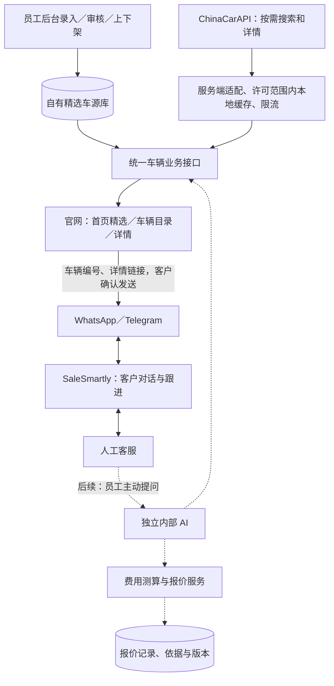

> 历史材料：用于追溯，不是当前执行指令或新服务器状态。开工请从[接手导航](../README.md)开始。

# 车源后台与业务平台开发规划

更新时间：2026-11-07（Asia/Shanghai）

状态：**已确认业务方向与先后顺序，执行计划 v1.0 已整理；功能尚未开发或部署。** 本文记录 2026-11-06～07 的讨论及最新纠正，不代表后台、数据库、第三方 API 或 AI 已存在。当前代码能力、实际验证与部署状态以[开发进度](../开发进度.md)为准；原[开发交接规划](旧开发交接规划.md)继续保留计算契约与历史研究，本轮之后的业务优先级以本文为准。

**分端开工入口：** [执行计划与协作规则](../../product/路线图.md)、[接口与数据约定](../开发/车辆接口.md)、[供应商与服务器选型](../../product/供应商与服务器选型.md)。用户确认先跑手工录入、发布、官网展示和人工询盘闭环，再接第三方；基础设施预算优先 150–300 元／月，必要时可加。后端／后台／前端／运维分工采用同一仓库与统一契约，详细里程碑以执行计划 G0–G6 为准；下文步骤是产品阶段概览。

## 1. 已确认的业务决策

1. 服务海外车商与个人客户，重点为俄罗斯、中亚、白俄罗斯，未来考虑更多欧洲市场。客户类型、报关身份、目的国、界面语言和交易币种分别记录，不能互相推定。
2. 首期目标是 **真实车源展示 → 客户询盘 → 人工报价 → 跟进**。
3. 用户已放弃接入原有车源平台，不再等待其接口文档。改为建设后台，由员工录入优质车源，存入自己的数据库，并可选择在首页展示。
4. 手工录入的车源称为“精选车源”，不自动宣称公司拥有库存；实车归属、供应商和可售情况须按事实记录。
5. 更多车源考虑接入 ChinaCarAPI。用户提出“最低套餐、按需查询、自己的后端统一给官网提供数据”；尚未购买或实测付费接口。后续补充 XAPI China／Apiauto 对照，首期只接最终选定的一家，供应商可替换，见选型记录。
6. 官网继续跳转 WhatsApp／Telegram，由客户确认发送预填消息，已接入的渠道将消息汇入 SaleSmartly。**官网不嵌入 SaleSmartly 聊天插件，不另建站内聊天或重复客服系统。**
7. SaleSmartly 继续维护客户沟通、客服分配与跟进。用户已确认开通相关 API／Webhook／自定义智能体功能；实际接口权限和渠道行为仍待实施时联调。
8. AI 先建设为独立内部工具，由员工主动提问、核对建议，再从 SaleSmartly 回复客户。验证后才接入 SaleSmartly 自动处理指定会话。
9. 后续内容矩阵、线索开发与允许的自动跟进继续汇入 SaleSmartly；不因长期规划而立即执行采集、营销或外部消息发送。

## 2. 当前实现与未来方案分开

- 当前仍为 Next.js 静态导出，19 条 mock 车辆、三语页面、共享联系草稿和七国参考计算；没有真实车源后台、业务数据库或线上查询 API。
- 真实车源后台与按需第三方详情需要运行时后端。推荐实施时评估 Next.js 服务端部署，保留可预渲染页面和现有模块边界；本轮不修改 `output: 'export'`，不假设加一个 API 即可自动生成所有新详情 URL。
- 计算核心继续通过 `@/modules/calculator` 公共接口调用，日期与汇率显式传入，不复制公式。现有规则官方核验完成项仍为 0，当前结果不是完整落地价；白俄罗斯和新增欧洲目的国须逐项补规则。
- 当前仍仅本地；新服务器未提供，不连接历史服务器。Docker Compose、PostgreSQL、对象存储等为候选部署方案，尚未安装或配置。

## 3. 混合数据架构（执行默认方案，尚未实现）

图示为目标方案，虚线为后续 AI／报价能力，不代表已经接通。后台密钥只保存在服务端；网页和未来 AI 均通过自有业务接口读取允许公开的数据，不直接依赖供应商字段或采购成本。

推荐查询路径为：先查许可有效期内的本地缓存，未命中／过期时再请求上游，并保存必要结果及过期时间。初期可由同一 PostgreSQL 实例的独立表保存精选车源与第三方缓存；二者的数据来源、维护规则和清理义务分开。按需缓存不等于对第三方全库建立完整镜像。

### 3.1 统一接口，不伪造统一结果集

执行计划默认：首页主要展示人工精选，目录使用“精选车源／更多车源”切换或明确分区；各自有筛选、分页、排序和数量。若后续要求真正混排，单独调整契约和成本，不让不同端各自拼接。

- 同一套卡片和详情展示类型可以复用，接口在内部区分 `manual` 与 `chinacarapi` 等来源。
- 将本地第一页和第三方第一页拼接，不能宣称得到所有车源的全局价格排序或去重后总量。首期不承诺这种结果。
- 筛选条件只在实际支持的来源内生效；不同来源的筛选能力、数量口径与错误状态要可表达。
- 如果以后需要真正的统一结果集，应先核对授权、套餐和规模，再同步必要字段并建立统一搜索索引，或另行设计并验证严格的聚合查询算法；不能只改前端拼接方式。
- 第三方失败只影响“更多车源”；精选车源和联系入口应正常。上游超时／额度耗尽不能显示为“没有车辆”。

### 3.2 精选车源后台的最小范围

建议包含员工登录与权限、车辆草稿、编辑、发布／下架、首页推荐和排序、图片管理、基础操作记录。具体账号方案与字段待实施前确认。

每条车源至少考虑：

- 稳定车源编号；品牌、车型、配置；生产日期精度与首次登记日期分开；里程、动力、排量／功率及单位、所在地和车况。
- 原始金额与币种、内部成本或采购参考价、公开售价及费用包含范围。没有确定售价时明确待询价，缺失值不写成零。
- 供应商／实车归属、可售／预订／售出／下架状态、最后人工核验时间。
- 图片、使用来源／权限、三语展示内容和首页展示设置；“精选”是运营选择，不替代检测、库存或出口资格确认。
- 修改人、修改时间及发布记录。录入规则不借用计算器演示默认值补齐真实事实。

精选若来自第三方挂牌，保存来源关联；手工转录不消除原数据／图片的授权和删除义务。

### 3.3 标识与价格约定

- 精选车源使用自有稳定 ID；第三方使用“供应商＋上游平台来源＋外部 ID”的稳定映射，不能用列表下标作为详情或询盘编号。ChinaCarAPI 内还包含不同来源，不能假定纯数字 ID 在所有来源间唯一。
- 同车型、同年款、相近里程不代表同一实车。可靠 VIN 或挂牌来源可辅助关联；证据不足时保留疑似重复状态，不自动合并。
- 采购参考价、对外展示价和针对客户的报价分别维护；第三方标价不自动等同我方售价或完整出口报价。
- 原币金额保留，外币展示记录汇率来源和时点。不同币种未经统一口径不能直接比较价格。
- 第三方“可出口”或检测标记只是来源提供的信息，不替代本项目对车况、库存、出口资格及目的国规则的核验。

## 4. ChinaCarAPI 评估记录

核对日期：2026-11-07。以下为公开文档事实，不等于付费账号实际验收。

| 项目 | 当前结论 |
| --- | --- |
| 独立 Starter | 官网按月标价 €99，含目录筛选、详情／照片、检测报告和价格历史 |
| Business | 官网按月标价 €149，增加变更数据流、全目录 CSV、最多 500 辆的批量查询 |
| €39 加购价 | 面向已有 EnCarAPI 订阅者，不是独立 Starter 价格 |
| 存储 | 官网允许自有平台／分析用途及订阅期存库；订阅结束须删除相关数据 |
| 通用限流 | 文档说明超过 600 次／分钟返回 429；这不是可承载访客数或无限调用承诺 |
| 付费额度 | 付费 Starter 的每日／每月总额度、计量单位、独立并发／秒级限制和超额处理尚未确认 |

来源：[中文官网与价格](https://chinacarapi.com/zh)、[英文官网](https://chinacarapi.com/)、[套餐对比](https://chinacarapi.com/compare)、[目录接口文档](https://chinacarapi.com/zh/documentation#zh/tag/catalog/GET/api/catalog)。

初步判断：**只做按需查询时，Starter 的功能范围可以作为首期候选；无需仅因“做公开官网”就推定必须购买 Business。** 最终选择取决于付费查询限额、实际访问量和使用许可，暂不承诺可承载的访客数量。

目录文档与公开 [OpenAPI](https://api.chinacarapi.com/openapi.json?lang=zh) 已只读核对以下约束，仍需付费账号的少量样例验证实际行为：

- `GET /api/catalog` 支持来源、品牌／车型、年款、首次上牌年份、CNY 价格、里程、功率、城市／燃料、报告等条件，以及时间、价格、里程和年份排序。`export_ready` 是供应商筛选口径，不等于法定资格保证。
- `page` 从 1 起，`limit` 默认 25、最高 100；同一查询分页可访问最多 10,000 条，不是全目录只有 10,000 辆。宽泛查询超过此范围时引导缩小条件，不生成不可访问的后续页；返回数量可能有缓存滞后。
- 单车详情使用 `/api/vehicle/{id}`，品牌／车型筛选字典可分别由 `/api/enums`、`/api/models` 支持；额外规格、按 URL 查询等能力的具体套餐权限需另核实，不纳入首期必需项。
- `firstRegistration` 是首次登记月份；`manufactureDate` 是独立出厂年月，部分记录为空。不能用登记日期或年款替代计算器所需的制造日期。第三方价格及其出口报价口径须按来源解析，不直接当我方采购成本。
- 图片链接可能有有效期，缓存要处理链接刷新；永久下载／重新托管的权限需另确认。
- 官方建议筛选字典与车辆详情缓存约 24 小时、列表缓存数小时，并建议从自有数据库向访客提供数据。最终 TTL 结合许可、实际新鲜度和报价前复核确定；缓存建议不构成库存有效期保证。

### 4.1 接入前必须落实的供应商条件

1. 付费 Starter 如何计量：请求次数、列表返回记录数、车辆详情查询数是否分别限制；每月／每日额度、独立并发限制、通用 600 次／分钟的限流范围和重试／超额行为。
2. 公开网站的多人查询是否符合具体公平使用条件；已公开缓存建议以外的结果复用、保存期限和下架要求。
3. 图片展示、直接引用、下载再托管及处理权限；第三方来源内容和订阅终止后的清理范围。历史报价中含第三方内容的保留方式也需要确认，不能默认永久保留全部源数据。
4. 列表、详情、筛选字典字段与权限的实际样例；已公开分页／排序边界、失败状态及撤下车辆行为的验证。
5. 数据新鲜度：官方不同页面对同步频率的表述存在差异；实时请求接口不等于原车源实时更新。区分供应商更新时间与本次获取时间，报价前再次核验。

试用额度不能替代付费套餐额度。免费开发能力也不能作为具备照片和详情的正式车源目录验收依据。本轮没有购买、开始付费试用、使用 API 密钥或调用付费业务接口。

### 4.2 服务端查询与成本控制

- 将供应商调用封装为一个适配器，统一校验输入、映射字段、隐藏密钥和非公开数据；密钥只用于服务端 `x-api-key` 请求头，不做可任意透传 URL／参数的公共代理。
- 在许可范围缓存筛选字典、热门查询和详情，缓存键包含有效筛选／排序／分页参数；合并并发相同请求，控制请求频率和超时。
- 列表只使用列表字段，用户打开详情后再查询详情；不在每张卡片渲染时批量调用完整详情。
- 分别记录上游调用数、返回记录数、详情查询数、缓存命中和失败原因，按套餐真实计量方式估算费用与容量。
- 旧缓存仅在业务与许可允许时使用，并明确时点和待核验状态；不得把缓存读取时间写成库存刷新时间。
- 不以 Starter 循环翻页搬完整库作为默认方案。需要本地全集和增量同步时，重新评估对应套餐及完整性维护。

## 5. 已确认的三点优化

### 5.1 询盘带车辆上下文

延续当前 `shared/lib/vehicle-contact.ts` 的统一草稿生成方式。真实车源阶段使用正式稳定编号，预填车型、详情链接及必要的展示事实；目的国等信息仅在客户已经选择时附带。

官网只打开 WhatsApp／Telegram 草稿，由客户确认发送。不能把打开链接记录成已发送，也不能把第三方挂牌 ID 或现有演示 slug 冒充我方真实库存归属。

### 5.2 点击和真实询盘分别统计

- 官网统计页面浏览、搜索、车辆详情和“点击联系／转出”。
- SaleSmartly／实际消息渠道收到客户消息后，才有真实咨询事实；新消息数、新会话数、有效询盘数分别定义和去重。
- 后续通过经核验的客户／会话标识、车辆编号和报价编号关联，避免把回调重试或同一客户的连续消息重复计成新询盘。
- 不从外链点击推断消息已送达，也不靠昵称或浏览器指纹强行合并跨渠道身份。

### 5.3 明确数据维护位置

| 数据 | 主要维护／事实来源 |
| --- | --- |
| 人工精选的车辆信息、发布状态、公开售价 | 自建后台与数据库，记录人工核验时间 |
| 第三方挂牌、原始标价与来源状态 | ChinaCarAPI，官网适配／缓存并保留来源，不自动成为我方库存 |
| 网站访问与点击 | 官网统计事件 |
| 客户消息、会话、分配与跟进 | SaleSmartly 及其已接入渠道 |
| 计算规则与测算结果 | 公共计算模块与版本化规则／汇率／费用来源 |
| 结构化报价、依据、有效期与版本 | 自有业务系统；发送记录关联 SaleSmartly 会话 |
| AI 建议 | 派生草稿，不作为库存、客户授权或正式金额的事实来源 |

## 6. AI 与后续获客的边界

内部 AI 先通过受控业务接口查车、调用参考测算、整理回复／报价草稿，由员工审核后在 SaleSmartly 回复。网站、后台和 AI 复用同一套车辆与计算服务。

后续接入路径为：客户在官网跳转的聊天软件或社媒发消息 → SaleSmartly → AI 接入模块 → 自有车源与报价服务 → SaleSmartly 回原渠道。官网仍不嵌客服插件。

AI 自动发送前要校验会话是否仍由 AI 接待；按消息 ID 去重，避免机器人自触发，超时与缺项可交人工。正式报价所需的国家规则、运费、库存核验和成本完整性，不因接入 AI 而自动满足。

后续获客分为内容引流与线索开发，客户交流统一进入 SaleSmartly。按渠道条件保存联系许可、退出和跟进状态；长期目标不构成本轮外部采集或消息发送授权。

## 7. 建议实施顺序与验收（尚未执行）

以下编号用于本专题，不覆盖历史 P1 版本记录。

| 步骤 | 交付范围 | 核心验收 |
| --- | --- | --- |
| 0：方案与供应商验证 | 精选字段／价格口径、Starter 限额与许可、少量样例映射、列表组织方式 | 已确认与未知分开；方案可实施，未用演示数值冒充真实条件 |
| 1：精选后台与真实展示 | 员工权限、录入／图片／发布／首页推荐、数据库与备份、运行时详情 | 保存与发布可验证，非公开字段不泄露；真实车号＋URL 草稿一致；已售／下架行为明确 |
| 2：更多车源按需查询 | ChinaCarAPI 适配、分页筛选、详情、缓存／限流、状态提示 | 与来源查询条件相符；精选不受上游故障影响；无伪造总量／全局排序，额度可观测 |
| 3：业务记录与统计 | SaleSmartly 消息／会话关联、报价记录、来源到询盘统计 | 联系点击与实际咨询分开，重复事件不重复计数，报价可追溯 |
| 4：独立内部 AI | 查车、收集缺项、测算与草稿、人工反馈 | 推荐车源存在，金额来自工具，未核验或缺失条件清楚展示 |
| 5：客服 AI 与获客扩展 | SaleSmartly 小范围 AI 接待、人工接管，随后按需要增加内容与线索流程 | 无重复／循环回复，人工优先、异常回退，效果按有效询盘和业务结果衡量 |

首期仍以人工报价开展业务；第 3 步是完善记录与自动统计，不要求等到第 3 步才允许人工在 SaleSmartly 接待。任何实际接入、部署、付费和对外发送按当时任务范围执行。

## 8. 后续输入和对应依赖

- G3：供应商最终选择、付费限额与图片／缓存许可；当前没有 API 密钥或实测结果。样本比较不阻塞先做精选。
- G0：按执行计划把统一契约、分别分页和运行时默认方案落码，锁定工具版本；真正混排不在首期。
- G1/G2：精选字段与发布流程已有契约草案；用户补充真实车辆、公开价格包含范围和图片来源，完成内容验收。
- OPS：预算和推荐配置已记录；新服务器实际购买与接入信息、存储和备份具体配置待落实。不能使用旧服务器资料代替。
- SaleSmartly 实际消息关联和报价发送／回执接口，后续通过已有账号能力验证。

本轮只维护规划、任务书、公开资料核验和文档一致性；功能实现状态不发生变化。后续由各端按任务书分阶段实施，本对话按用户询问汇总实际证据和进度。
