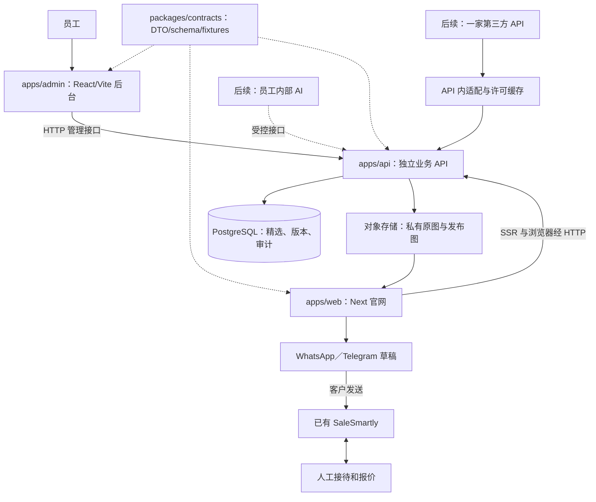

# 产品路线图

版本：v1.3｜2026-11-08（Asia/Shanghai）｜维护：产品／项目管理。

本文件是当前产品范围与分期方案。实际完成情况见 [当前进度](../docs/开发进度.md)，职责、协作与记录规则统一见 [接手导航](../docs/README.md)。后端、后台与官网运行时功能仍待对应任务实施。

**已采纳的架构（2026-11-08）：** 用户确认一个 Git 仓库管理多个独立应用。官网源码、资源、测试和应用配置已迁至 `apps/web/`，保持静态 export；`apps/admin/`、`apps/api/`、`packages/contracts/` 与 `packages/calculator-core/` 当前只有预留 package，不具备真实功能或运行能力。工程迁移验证见当前进度及本轮日志；它不等于整个 G0 完成。业务 G1–G6 顺序不变。

## 1. 产品范围和默认决策

用户明确的顺序：**手工精选车源闭环 → 第三方目录 → 业务统计与报价记录 → 独立内部 AI → SaleSmartly AI 接待与后续获客。** 放弃旧自有平台接口。

官网经 WhatsApp／Telegram 打开草稿，客户确认发送后消息进入已有 SaleSmartly；不嵌客服插件，不另建 CRM。后台的“客户跟进”能力不在首期范围。官网保持中英俄三语、现有视觉与计算模块边界。真实车源不是自动拥有库存，也不自动具有出口资格。

本计划采用以下技术默认值，后续若改变须记录原因和受影响任务，不让不同对话各自选择：

- 一个 Git 仓库、pnpm workspace 与统一锁文件：`apps/web` 为 Next.js 官网，`apps/admin` 目标为 React/Vite 员工后台，`apps/api` 为独立 TypeScript 服务，API 框架由 BE-01 选定。应用各自声明依赖、配置与构建产物，可独立发布；根共享文件由当轮工程集成人统一修改。具体边界见 [仓库与目录边界](../docs/开发/模块维护.md#仓库与目录边界)。
- 公共 DTO、运行时 schema 和 fixtures 归 `packages/contracts`，由 BE-01 先落实供三端消费；禁止跨应用源码导入。`packages/calculator-core` 仅预留，现有计算核心留在官网；有真实第二消费者后单独安排提取，不先行搬空官网模块。
- PostgreSQL 保存人工车源、发布版本、操作记录；第三方上线后增加独立缓存表。初期不引入 Redis、搜索集群、消息集群或微服务。
- 图片走独立对象存储；本地开发可用隔离的文件适配器，生产不把上传图片写进应用镜像。图片、数据库和备份分别管理。
- 一个主服务器用 Docker Compose 管理官网运行时、API、数据库及反向代理，后台作为独立静态产物托管；官网当前静态托管在 FE-01 后才切换。三端代理路径、Cookie／CSRF／CORS 和独立回滚由 OPS 联合应用负责人验证。数据库不开放公网。该方案存在单机故障点，备份不能替代高可用。
- 目录默认“精选／更多车源”分区，各自分页。第三方首期只启用一家，经适配器可替换；不承诺全球混排、精确跨源去重或本地全库镜像。
- 初期基础设施预算 150–300 元／月，必要时可增加；不含车源 API、AI 和域名续费。AI 后续先调用外部模型，不买 GPU。
- 员工后台默认中文入口，沿用三语语义 key；网站内容有独立的三语发布状态，禁止把未翻译内容伪装成已完成三语。

这些是可执行的方案默认值，不是已上线事实；BE-01 落定 API 框架、鉴权与数据库工具版本，AD-00 建立后台工程，FE-01 迁移官网运行时；服务器 SKU 在 OPS-02、供应商在 G3 前验证并登记，不把采购作为本地 G0 的前置条件。

### 需要一直保留的三个产品约定

1. **询盘有车辆上下文：** 所有具体车辆入口复用共享草稿，带稳定车号、基本事实和详情 URL；客户自行确认发送。相同车辆在不同页面不能生成不同身份。
2. **点击与询盘分开：** 页面浏览、联系点击、实际收到消息、有效询盘和人工报价分别统计。点击不证明发送成功；真实询盘日后通过 SaleSmartly 事件关联、去重，未打通前不伪造转换率。
3. **明确数据由谁维护：** 人工精选事实、图片与发布状态由自有后台维护；市场挂牌由供应商负责并按许可缓存；会话与客户跟进在 SaleSmartly；计算规则当前由官网计算模块维护，未来按真实复用需求提取共享包，正式报价保留依据、版本和人工确认。

面向海外车商与个人，主要市场为中亚、俄罗斯、白俄罗斯并逐步扩展欧洲。用户国家、客户身份、语言和币种分别收集；当前七国计算器不自动代表所有目标市场已有规则。AI 报价需要车辆事实、有效规则、运输方案和缺项追问，不能靠模型猜税率或将参考合计当最终承诺。自动获客后续另定渠道、触达条件和人工接管流程。

## 2. 目标架构

图示为目标数据流，API、后台与 contracts 尚未实现。官网 SSR 经 HTTP 请求独立 API 的公开白名单 DTO，浏览器经约定代理或受限跨域访问；不得直接 import 后端服务或数据库模型。共享 contracts 使契约可检查，不代表独立发布的应用版本会自动同步。未来共享计算包必须保持纯函数与显式日期／汇率输入，按真实消费者需求提取。

## 3. 阶段、依赖和验收门槛

| 阶段 | 任务和主责 | 完成条件 |
| --- | --- | --- |
| G0：工程与共同基础 | FE-00 工程迁移；BE-01 契约／API／鉴权／数据库；AD-00 后台工程；PM 协调 | 工作区可复现；各应用职责与依赖边界有效；契约落码、API／后台基础工程可运行，身份和数据库基础有验证。当前仅官网迁移，不将整个阶段记完成 |
| G1：一辆车闭环 | BE-02、AD-01、FE-01；QA 联调、PM 核验 | 登录→录入一辆车和照片→草稿不可见→发布→首页及新详情可见→正确询盘草稿→下架同步 |
| G2：精选可运营 | BE-03、AD-02、FE-02、OPS-01/02 | 编辑不误改线上、权限／冲突／失败处理可用；10–20 辆真实车人工验收；备份恢复与新环境发布通过 |
| G3：第三方目录 | PM-02、BE-04、FE-03、OPS-03 | 供应商样例／额度／许可验证；真实筛选分页和缓存；上游失败不影响精选 |
| G4：统计和报价记录 | 后端、前端、后台协作 | 浏览／转出／真实询盘口径分开；SaleSmartly 事件去重关联；报价依据可追溯 |
| G5：内部 AI | 后端、后台协作 | 员工查车、缺项追问、工具测算、人工审核；不自行对客承诺金额 |
| G6：客服 AI／获客 | PM 另开阶段 | SaleSmartly 小范围接入、人工接管和异常回退验证，再扩展获客 |

G1 可以先在本地完成，不需要先购买 API；OPS 可并行准备部署模板。完整客服收件链路的实发验收由用户用自有测试账号完成或明确委托，不向真实客户发送测试消息。链接正确不等于消息已经送达。

建议把 G0、G1 拆成可当次验收的小交付，再根据实测工作量排期；目前没有足够依据承诺具体上线日期。10–20 辆是 G2 建议首批样本数量，不是系统容量限制。

## 4. 交付流程与通用验收

实现者完成分配任务并自测 → 独立审查者只读 review → QA 验证跨端集成及缺陷复测 → PM 核对版本／范围／环境与阶段证据 → 用户业务／视觉验收 → OPS 按授权发布、冒烟并准备回滚。单端任务无联调依赖时可跳过跨端步骤，不能跳过必要验证；具体状态、严重度、报告字段和测试范围按 [测试与审查](../docs/协作/测试与审查.md)。P0/P1 阻塞验收，P2 须记录负责人、处理计划及接受依据。没有发现问题不证明没有 bug；文档不会自动监控其他对话或替用户验收。

- 数据：草稿／内部成本／供应商联系方式不可公开；已售和下架行为清楚；图片失败有降级，缺失数据不填 0。
- 发布：新车无需重建整站即可访问；编辑草稿不影响已发布版；发布、停售、下架导致相关缓存失效。
- 产品：现有首页结构和动效保留，真实车源分组标题符合内容，中文／英语／俄语和手机无破坏。
- 业务：同车稳定 ID、详情地址和询盘草稿一致；不把按钮点击算真实询盘；税费仍按原参考能力表达。
- 工程：生产模式构建／启动、模块与服务端边界、关键权限／发布／联调测试通过；不再用旧静态 `out/` 作为新运行时验收对象。
- 运维：真实备份可恢复；应用可回滚，迁移兼容条件有记录；秘密不进仓库，数据库无公网端口。

## 5. 已定决策

| ID | 决策 | 理由与状态 |
| --- | --- | --- |
| D-01 | 先精选纵向闭环，后第三方 | 用户确认开发顺序；降低供应商依赖 |
| D-02 | 已采纳单仓多应用与共享 packages | 用户确认 web/admin/api 各自依赖与部署；官网已迁移，其他目录仅预留，业务服务与后台待实施 |
| D-03 | 官网静态→运行时由 FE-01 执行；API 由 BE-01 独立建立 | 新车详情 SSR 需要官网运行时；目录迁移保持静态，后台独立 React/Vite，不依赖 Next 布局 |
| D-04 | 精选／市场分区 | 默认方案；保证分页排序语义，未来混排另立任务 |
| D-05 | 基础设施 150–300 元／月优先 | 用户明确；有必要可增，不含 API／AI |
| D-06 | 第三方供应商保持可替换 | ChinaCarAPI 为候选，XAPI China／Apiauto 样本比较后选择 |
| D-07 | 单一接手导航、角色摘要与独立日志 | 用户要求降低接手成本；PM 汇总证据，旧规划与部署归档 |
| D-08 | 自测、独立 review、QA、PM 和用户分工验收 | 用户要求整套测试／审查／阶段验收流程；作者不替代独立审查，Git 与发布分开记录 |

仍需外部输入的项目仅阻塞对应任务：首辆真实车源和图片来源阻塞 G1 的真实内容验收、首批完整资料阻塞 G2 内容验收；服务器实际购买信息阻塞生产部署；供应商额度／许可和密钥阻塞 G3 真实接入。它们不阻塞 G0 或 G1 使用明确标记的测试数据开展本地开发；测试样例通过不等于真实车辆验收完成。
