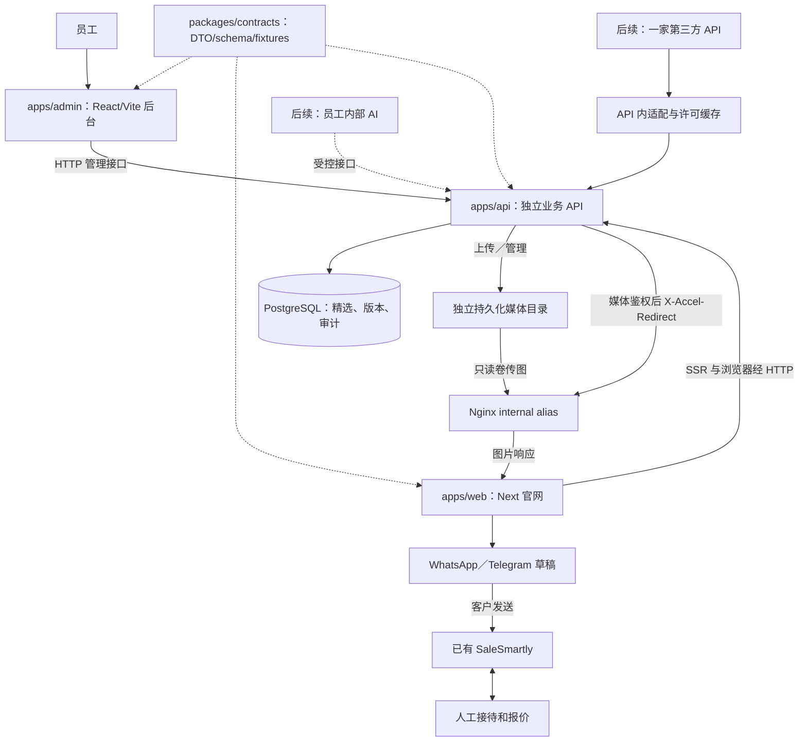

# 产品路线图

版本：v1.7｜2026-11-08（Asia/Shanghai）｜维护：产品／项目管理。

本文件是当前产品范围与分期方案。实际完成情况见 [当前进度](../docs/开发进度.md)，职责、协作与记录规则统一见 [接手导航](../docs/README.md)。具体能力与验证以角色记录为准。

**已采纳的架构（2026-11-08）：** 用户确认一个 Git 仓库管理多个独立应用。官网在 `apps/web/`，独立后台在 `apps/admin/`，API 在 `apps/api/`，公共契约在 `packages/contracts/`，计算核心共享包仍预留。PM-INT-02已完成官网Node运行时和三端本地技术联调；PM-INT-03已完成真实查询交互、删除／资料录入及OPS本机可迁移运行的本轮技术验收，待用户业务／视觉确认。最新证据见当前进度，不把任务分派当已实现或已部署。

### 当前上线决定（2026-11-08）

用户已购买阿里云香港国际型Ubuntu 24.04／x86_64／4核标称8GB／约70GB服务器，OPS已准备运行环境；采购事实与预算区别见[选型记录](供应商与服务器选型.md#当前采购与上线决定2026-11-08)。用户明确授权先准备新机，等各端当前新增任务完成、自测和独立审查后，由PM更新文档、保存最新提交，再按该版本部署。`fdf6c6b`保留为历史阶段基线，不再固定首发。FE-UX-04真实筛选、多语展示I18N02等仍在开发；新机最终应用、证书、数据迁移和验收尚未完成。

官网`cars.hongdingauto.com`与后台`admin.hongdingauto.com`独立同源运行，阿里DNS由用户解析，根域及其他记录保留。最终结果由PM在当前对话交付，用户已取消贾维斯通知。该授权仅覆盖本轮明确的新服务器和任务，不包括旧服务器或未分派的长期模块。

## 1. 产品范围和默认决策

用户明确的顺序：**手工精选车源闭环 → 第三方目录 → 业务统计与报价记录 → 独立内部 AI → SaleSmartly AI 接待与后续获客。** 放弃旧自有平台接口。

官网经 WhatsApp／Telegram 打开草稿，客户确认发送后消息进入已有 SaleSmartly；不嵌客服插件，不另建 CRM。后台的“客户跟进”能力不在首期范围。官网保持中英俄三语与计算模块边界；PM-INT-03按用户指定参考项目还原现有五类页面和导航交互，品牌、数据及真实业务规则使用HD自身内容。真实车源不是自动拥有库存，也不自动具有出口资格。

本计划采用以下技术默认值，后续若改变须记录原因和受影响任务，不让不同对话各自选择：

- 一个 Git 仓库、pnpm workspace 与统一锁文件：`apps/web` 为 Next.js 官网，`apps/admin` 目标为 React/Vite 员工后台，`apps/api` 为独立 TypeScript 服务，API 框架由 BE-01 选定。应用各自声明依赖、配置与构建产物，可独立发布；根共享文件由当轮工程集成人统一修改。具体边界见 [仓库与目录边界](../docs/开发/模块维护.md#仓库与目录边界)。
- 公共 DTO、运行时 schema 和 fixtures 归 `packages/contracts`，由 BE-01 先落实供三端消费；禁止跨应用源码导入。`packages/calculator-core` 仅预留，现有计算核心留在官网；有真实第二消费者后单独安排提取，不先行搬空官网模块。
- PostgreSQL 保存人工车源、发布版本、操作记录；第三方上线后增加独立缓存表。初期不引入 Redis、搜索集群、消息集群或微服务。
- 图片首期保存在本机／未来自有服务器的独立持久化目录。正式部署路径由API鉴权并返回`X-Accel-Redirect`，Nginx通过`internal alias`和只读媒体卷实际传图；不得直接公开整个目录。稳定媒体标识／相对key不绑定本机路径，应用重建不丢文件，数据库与媒体联合备份恢复。原生API直接传图仅兼容开发；当前Compose实测状态见进度。以后有容量、流量或容灾需要再迁OSS，首期无需采购。
- 一个主服务器用 Docker Compose 管理官网运行时、API、数据库及反向代理，后台作为独立静态产物托管；官网已在本地实施 Node 运行时，生产方案仍待 OPS 落实。三端代理路径、Cookie／CSRF／CORS 和独立回滚由 OPS 联合应用负责人验证。数据库不开放公网。该方案存在单机故障点，备份不能替代高可用。
- 目录公开使用“精选车源／更多车源”分区，各自分页；展示文案与内部事实边界统一见下方约定。第三方API首期只启用一家，经适配器可替换；不承诺全球混排、精确跨源去重或本地全库镜像。PM-INT-03先人工整理少量中国境内实际挂牌作本地多图与筛选联调，内部保留来源、采集时间和未知库存，区别于G3自动供应商接入。
- 初期基础设施预算 150–300 元／月，必要时可增加；不含车源 API、AI 和域名续费。AI 后续先调用外部模型，不买 GPU。
- 员工后台默认中文入口，沿用三语语义 key；网站内容有独立的三语发布状态，禁止把未翻译内容伪装成已完成三语。

这些是可执行的方案默认值，不是已上线事实；BE-01 落定 API 框架、鉴权与数据库工具版本，AD-00 建立后台工程，FE-01 迁移官网运行时；服务器已购买并由OPS-02核验，最终新机运行验收仍待完成；供应商在 G3 前验证并登记，不把采购作为本地 G0 的前置条件。

### 当前公开展示与交互

以下为PM-INT-03用户最新要求，覆盖早期强制公开来源／样例提示与激活核对的验收口径；实现状态另见当前进度。

- 公开分区使用“精选车源／更多车源”；不显示“第三方”“库存待核验”“demo／展示样例”等旧模板标签或整页提示。旧HD6／7样例按本轮分派下架并保留后台记录，不能仅去掉标签后继续冒作真实车辆展示。当前8辆公开三语介绍改为可确认的中性车辆事实。
- 文案调整不改变内部来源、图片出处／许可待核验、`unknown`库存、空核验时间或`machine／pending`状态，不伪造现货、可售、已核验、人审或出口资格。价格仍按实际参考口径，不包装成本公司已确认报价；事实冲突保留缺失值及必要的事实说明。
- 客户沟通区域改为中性服务咨询内容，不捏造真实客户评价或对话；修复流程／沟通卡片hover上部裁切。页面／路由、显式筛选分页和手动刷新仍消费真实API。
- 取消`focus`／`visibilitychange`激活时的数据核对与请求，不再以切回窗口触发重取作为验收要求；也不得因此隐藏整块`main`、刷新整页或新增假等待。服务端发布、下架、删除与访问权限继续有效，浏览器历史和显式请求按真实场景验证。

所有后续开发均考虑正式部署方式；发布权限以当前用户任务为准，本轮最新授权与条件见上方当前上线决定。当前媒体方案的具体契约由BE维护，Nginx／持久化与迁移步骤由OPS维护；本轮需验证API鉴权、Nginx实际传输、草稿／下架／删除媒体不可绕过访问，以及新数据冻结后的整体恢复。

### 需要一直保留的三个产品约定

1. **询盘有车辆上下文：** 所有具体车辆入口复用共享草稿，带稳定车号、基本事实和详情 URL；客户自行确认发送。相同车辆在不同页面不能生成不同身份。
2. **点击与询盘分开：** 页面浏览、联系点击、实际收到消息、有效询盘和人工报价分别统计。点击不证明发送成功；真实询盘日后通过 SaleSmartly 事件关联、去重，未打通前不伪造转换率。
3. **明确数据由谁维护：** 人工精选事实、图片与发布状态由自有后台维护；市场挂牌事实来自原供应方，人工整理时保留来源和采集时间，后续API缓存按许可维护；会话与客户跟进在 SaleSmartly；计算规则当前由官网计算模块维护，未来按真实复用需求提取共享包，正式报价保留依据、版本和人工确认。

面向海外车商与个人，主要市场为中亚、俄罗斯、白俄罗斯并逐步扩展欧洲。用户国家、客户身份、语言和币种分别收集；当前七国计算器不自动代表所有目标市场已有规则。AI 报价需要车辆事实、有效规则、运输方案和缺项追问，不能靠模型猜税率或将参考合计当最终承诺。自动获客后续另定渠道、触达条件和人工接管流程。

## 2. 目标架构

图示为目标数据流，实际完成情况见当前进度。官网 SSR 经 HTTP 请求独立 API 的公开白名单 DTO，浏览器经约定代理或受限跨域访问；不得直接 import 后端服务或数据库模型。共享 contracts 使契约可检查，不代表独立发布的应用版本会自动同步。未来共享计算包必须保持纯函数与显式日期／汇率输入，按真实消费者需求提取。

## 3. 阶段、依赖和验收门槛

| 阶段 | 任务和主责 | 完成条件 |
| --- | --- | --- |
| G0：工程与共同基础 | FE-00 工程迁移；BE-01 契约／API／鉴权／数据库；AD-00 后台工程；PM 协调 | 工作区可复现；各应用职责与依赖边界有效；契约落码、API／后台基础工程可运行，身份和数据库基础有验证。实际能力与阶段证据见当前进度，不因目录或单端存在直接判定阶段完成 |
| G1：一辆车闭环 | BE-02、AD-01、FE-01；QA 联调、PM 核验 | 登录→录入一辆车和照片→草稿不可见→发布→首页及新详情可见→正确询盘草稿→下架同步 |
| G2：精选可运营 | BE-03、AD-02、FE-02、OPS-01/02 | 编辑不误改线上、权限／冲突／失败处理可用；10–20 辆真实车人工验收；备份恢复与新环境发布通过 |
| G3：第三方目录 | PM-02、BE-04、FE-03、OPS-03 | 供应商样例／额度／许可验证；真实筛选分页和缓存；上游失败不影响精选 |
| G4：统计和报价记录 | 后端、前端、后台协作 | 浏览／转出／真实询盘口径分开；SaleSmartly 事件去重关联；报价依据可追溯 |
| G5：内部 AI | 后端、后台协作 | 员工查车、缺项追问、工具测算、人工审核；不自行对客承诺金额 |
| G6：客服 AI／获客 | PM 另开阶段 | SaleSmartly 小范围接入、人工接管和异常回退验证，再扩展获客 |

G1 可以先在本地完成，不需要先购买 API；OPS 可并行准备部署模板。完整客服收件链路的实发验收由用户用自有测试账号完成或明确委托，不向真实客户发送测试消息。链接正确不等于消息已经送达。

建议把 G0、G1 拆成可当次验收的小交付，再根据实测工作量排期；目前没有足够依据承诺具体上线日期。10–20 辆是 G2 建议首批样本数量，不是系统容量限制。

## 4. 交付流程与通用验收

实现者完成分配任务并自测 → 独立审查者只读 review → QA 验证跨端集成及缺陷复测 → PM 核对版本／范围／环境与阶段证据 → 用户业务／视觉验收 → OPS 按授权发布、冒烟并准备回滚。单端任务无联调依赖时可跳过跨端步骤，不能跳过必要验证；具体状态、严重度、报告字段和测试范围按 [测试与审查](../docs/协作/测试与审查.md)。P0/P1 阻塞验收，P2 须记录负责人、处理计划及接受依据。没有发现问题不证明没有 bug；文档不会自动监控其他对话或替用户验收。

- 数据：草稿／内部成本／供应商联系方式不可公开；已售和下架行为清楚；图片失败有降级，缺失数据不填 0。
- 发布：新车无需重建整站即可访问；编辑草稿不影响已发布版；发布、停售、下架导致相关缓存失效。
- 产品：按用户确认的参考范围还原现有页面和有效交互，保留HD品牌、三语及真实资料语义；参考中的模拟事实、固定等待、假操作和响应式缺陷不作为还原目标。截图对照和实际交互共同验收。
- 业务：同车稳定 ID、详情地址和询盘草稿一致；不把按钮点击算真实询盘；税费仍按原参考能力表达。
- 工程：生产模式构建／启动、模块与服务端边界、关键权限／发布／联调测试通过；不再用旧静态 `out/` 作为新运行时验收对象。
- 运维：真实备份可恢复；应用可回滚，迁移兼容条件有记录；秘密不进仓库，数据库无公网端口。

## 5. 已定决策

| ID | 决策 | 理由与状态 |
| --- | --- | --- |
| D-01 | 先精选纵向闭环，后第三方 | 用户确认开发顺序；降低供应商依赖 |
| D-02 | 已采纳单仓多应用与共享 packages | 用户确认 web/admin/api 各自依赖与部署；实际工程能力见当前进度 |
| D-03 | 官网静态→运行时由 FE-01 执行；API 由 BE-01 独立建立 | 新车详情 SSR 需要官网运行时；目录迁移保持静态，后台独立 React/Vite，不依赖 Next 布局 |
| D-04 | 精选车源／更多车源分区 | 保证分页排序语义，公开名称按D-15更新，未来混排另立任务 |
| D-05 | 基础设施 150–300 元／月优先 | 用户明确；有必要可增，不含 API／AI |
| D-06 | 第三方供应商保持可替换 | ChinaCarAPI 为候选，XAPI China／Apiauto 样本比较后选择 |
| D-07 | 单一接手导航、角色摘要与独立日志 | 用户要求降低接手成本；PM 汇总证据，旧规划与部署归档 |
| D-08 | 自测、独立 review、QA、PM 和用户分工验收 | 用户要求整套测试／审查／阶段验收流程；作者不替代独立审查，Git 与发布分开记录 |
| D-09 | 后台采用成熟 UI 库，首批批量操作为库存更新与下架 | 用户要求改善表格与录入体验；服务端逐条权限、版本和结果校验，失败可定位；不自动批量发布 |
| D-10 | 历史：PM-INT-02两条非库存车型样例 | 当时用于数据／界面联调，不替代真实车源验收；PM-INT-03由D-15覆盖公开展示决定，原样例下架并保留内部事实和记录 |
| D-11 | 现有五类官网页面及导航以用户提供参考项目还原 | PM-INT-03用户确认首页／目录／详情／购车指南／计算器范围；拍卖、配件、物流、博客等另排。保留SSR首屏，真实筛选分页与局部更新由FE／BE协作，不照搬mock全库过滤或人为等待 |
| D-12 | 图片先存本机及未来自有服务器的独立数据目录 | 用户优先节约成本和整体迁移；D-16明确Nginx传输路径，OPS落实持久化与DB＋媒体恢复，不以OSS采购为前置 |
| D-13 | 后台增加可恢复删除，与下架分开 | 用户要求删除车源；本轮采用逻辑删除／恢复至未发布草稿的实施方案，鉴权、版本、幂等、审计与公开不可见性由BE保证；不做永久清空 |
| D-14 | 本地增加中国境内第三方实际挂牌与多图资料 | 用户确认中国境内、适合出口的筛选方向，每辆尽量8张以上同车照片；首批目标8–12辆，项目助理整理并经管理API导入，内部保留来源／采集时间／参考价／未知库存，公开文案遵循D-15，不能冒称现货或已验证出口资格 |
| D-15 | 公开中性事实文案、取消激活核对并修复hover裁切 | 用户最新确认；规则集中维护于[当前公开展示与交互](#当前公开展示与交互)，FE更新界面、PA下架旧样例并整理三语，内部来源／库存／审核事实不变；实际完成另记 |
| D-16 | API鉴权、Nginx传输本机／同服务器图片，未来再迁OSS | 用户要求从现在起考虑正式部署；BE／OPS协作`X-Accel-Redirect`与`internal alias`，Nginx只读媒体卷，直接传图保留开发兼容；本机Compose鉴权传图、真实恢复与最终组合已通过本轮技术验收，用户确认和生产部署另计 |
| D-17 | 香港新机按各端完成后的最新受审提交部署 | 用户覆盖固定fdf6c6b首发约定；OPS先准备，PM待当前任务收口后统一提交，再部署与验收；两域及采购事实见上方当前上线决定 |

PM-INT-03仅进行本机数据体验和技术验收。正常公开挂牌资料与照片可先本地整理导入并登记出处、许可待核验；不能将此记录成已获商用授权，生产公开使用另行核验。没有足够同车照片时记真实数量，不重复封面、拼车型图库或生成图凑数。该批资料不是G2真实库存人工验收或G3供应商自动接入完成的证据。

仍需外部输入的项目仅阻塞对应任务：首辆真实车源和图片来源阻塞 G1 的真实内容验收、首批完整资料阻塞 G2 内容验收；服务器信息已提供，当前最终版本收口、域名解析／证书和新机迁移验收仍是上线条件；供应商额度／许可和密钥阻塞 G3 真实接入。它们不阻塞 G0 或 G1 使用明确标记的测试数据开展本地开发；测试样例通过不等于真实车辆验收完成。
